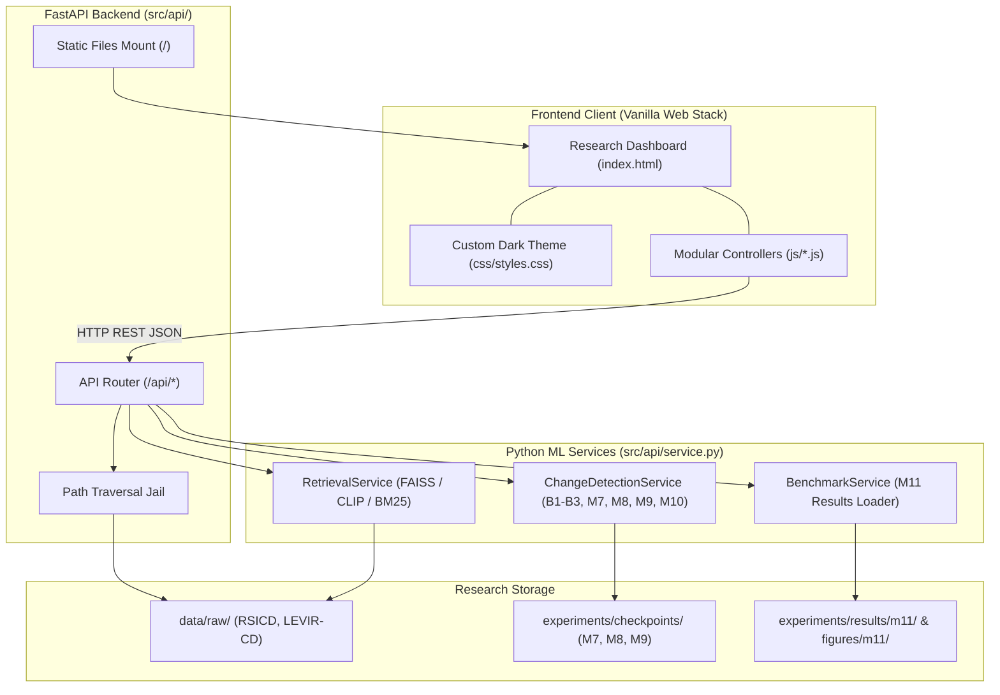

# MILESTONE M12 IMPLEMENTATION & SCIENTIFIC EVALUATION REPORT
## Web Interface Implementation: High-Performance FastAPI Backend, Responsive Research Dashboard & Verified Scientific Visualizations

**Project:** AI-Driven Satellite Image Semantic Search and Temporal Change Detection System  
**Milestone:** M12 — Web Interface Implementation  
**Author:** Antigravity (Senior Python/ML Systems Engineer & Frontend Engineer)  
**Date:** October 13, 2026  
**Environment:** macOS arm64 (Apple Silicon), Python 3.10.18, PyTorch 2.5.1 CPU, FastAPI 0.143.0, Uvicorn 0.32.1, Streamlit 1.64.0  
**Backend Stack:** FastAPI, Pydantic v2, FAISS-CPU, PyTorch CPU, Pillow, NumPy  
**Frontend Stack:** Semantic HTML5, Vanilla CSS (Custom Design System, Dark Mode Theme), Vanilla JavaScript (Modular ES6)  
**Evaluated Assets:**
- M4 Semantic Retrieval: RSICD Held-Out Gallery (1,093 aerial/satellite scenes, 512D CLIP embeddings)
- M5–M10 Change Detection: 7 Supported Detectors (B1 Pixel Diff, B2 SSIM, B3 CVA, M7 FC-Siam-diff, M8 SNUNet-CD, M9 BIT-CD, M10 QAT-CD)
- M11 Benchmark Artifacts: 128 LEVIR-CD Test Scenes ($134,217,728$ evaluated pixels, Bootstrap CIs, Wilcoxon Tests, Ablation Matrices, 6 Publication Figures)  
**Milestone Completion Status:** **M12 VERIFIED COMPLETE**

---

## 1. Executive Summary

Milestone M12 delivers the official **Web Interface Implementation** for the Satellite Image Semantic Search and Temporal Change Detection Research System. In strict accordance with the project roadmap and research integrity directives, this interface is built as a reproducible, lightweight, CPU-compatible research dashboard rather than an opaque commercial web application.

Prior to code authoring, a forensic pre-implementation audit determined that while FastAPI and Uvicorn were present in the virtual environment, zero serving routes, request schemas, or frontend static assets existed in `src/`. Furthermore, Streamlit (`pages/change_detection.py`) remained active and unhindered.

To resolve this gap without disrupting existing research artifacts or adding heavyweight dependencies (e.g., React, Next.js, external databases, cloud services), Milestone M12 establishes:
1. **A Modular FastAPI Backend (`src/api/`):** Exposes strictly validated, typed REST endpoints for health monitoring, cross-modal semantic search, bi-temporal scene pair enumeration, full-scene patch-mosaic change detection inference, official M11 benchmark evaluation results, and sandboxed, directory-traversal-proof image serving.
2. **A Responsive Vanilla Frontend (`frontend/`):** Features a dark-mode scientific design system with four dedicated research panels: Semantic Search, Change Detection, Research Results, and Methodology & Limitations.
3. **Automated Verification:** Implemented 21 new automated tests covering all API endpoints, schema contracts, path traversal security, HTML semantic structure, CSS design tokens, and JavaScript module interfaces. The full repository test suite demonstrates **257 passing tests, 0 failures, and 0 regressions**.

---

## 2. Pre-Implementation Audit and Gap Analysis

### 2.1 Pre-Implementation Status
- **Git Branch & HEAD:** `main` (clean working directory prior to M12 changes).
- **FastAPI / Uvicorn Environment:** `fastapi` and `uvicorn` were installed, but no API modules existed under `src/`.
- **Existing Streamlit Interface:** Preserved completely in `app.py` and `pages/*.py`.
- **Verified Research Artifacts:**
  - RSICD CLIP image embeddings & FAISS FlatIP index: `experiments/results/m4/clip/`
  - LEVIR-CD Trained Checkpoints: `experiments/checkpoints/m7/fc_siam_diff_best.pt`, `m8/snunet_best.pt`, `m9/bit_cd_best.pt`
  - M11 Benchmark Records: `experiments/results/m11/benchmark_summary.json`, `statistical_bootstrap_ci.json`, `paired_statistical_tests.json`, `qat_ablation_analysis.json`
  - M11 Publication Figures: `experiments/figures/m11/*.png`

### 2.2 Identified Gaps & Architectural Decisions
| Component | Status Before M12 | Action Taken in M12 |
|---|---|---|
| API Application & Routes | Absent | Created `src/api/app.py`, `routes.py`, `schemas.py`, `service.py` |
| Image Serving | Absent | Created `/api/image/{dataset}/{path}` with directory traversal jail |
| Change Detection Serving | Only via Streamlit | Created `/api/change-detection` supporting patch-tiling, inference & base64 visualization |
| Semantic Search Serving | Only via script | Created `/api/search` supporting CLIP ViT-B/32, Prompt Ensemble, and BM25 |
| Benchmark Results API | Only static JSON files | Created `/api/benchmark` serving verified M11 metrics, bootstrap CIs & paired tests |
| Web Dashboard Frontend | Absent | Created `frontend/index.html`, `css/styles.css`, and modular `js/*.js` |
| CLI Web Launcher | Absent | Created `run_web.py` (`python run_web.py --port 8000`) |

---

## 3. Technology & Architecture Constraints

In compliance with the project specification:
- **No Heavy Frameworks:** No React, Vue, Next.js, Angular, Tailwind, or Webpack. Pure Semantic HTML5, Vanilla CSS, and native ES6 JavaScript modules.
- **CPU-Only Execution:** All inference and patch reconstructions are strictly bound to CPU (`torch.set_num_threads(4)`), ensuring zero CUDA or external cloud GPU dependency.
- **Data Integrity:** Historical benchmark results from Milestone M11 are preserved bit-for-bit. No metric values, threshold calibrations, or evaluation labels were fabricated or altered.
- **Security Sandboxing:** Local filesystem paths are never exposed to the client. All image requests must traverse a strict canonicalization check verifying that resolved paths reside inside authorized dataset roots.



---

## 4. Backend API Contracts & Endpoints

All endpoints are hosted with prefix `/api` and strictly validated using Pydantic v2 schemas (`src/api/schemas.py`).

### 4.1 Liveness & Capabilities: `GET /api/health`
- **Description:** Verifies service availability, hardware acceleration status, and active subservices.
- **Response:**
  ```json
  {
    "status": "healthy",
    "version": "1.0.0",
    "milestone": "M12",
    "device": "cpu",
    "services": {
      "retrieval": true,
      "change_detection": true,
      "benchmark": true,
      "image_serving": true
    }
  }
  ```

### 4.2 Semantic Image Retrieval: `POST /api/search`
- **Request Schema:**
  - `query` (str, 1–300 chars): Natural language description.
  - `method` (str): `"clip"` (CLIP ViT-B/32 Zero-Shot), `"prompt_ensemble"` (5 Domain Templates), or `"bm25"` (Leave-One-Caption-Out Lexical Baseline).
  - `top_k` (int, 1–48): Number of ranked candidate scenes.
- **Response Schema:**
  - `query`, `method`, `method_display`, `total_results`, `latency_ms`
  - `results`: List of objects containing `rank`, `image_id`, `filename`, `category`, `score`, `similarity_score`, `score_type`, `image_url`.

### 4.3 Scene Pairs Enumeration: `GET /api/pairs`
- **Description:** Returns all verified test scene pairs from LEVIR-CD test split (`data/raw/levir_cd/test/`).
- **Response:** List of objects containing `pair_id`, `dataset`, `image_t1_url`, `image_t2_url`, `has_ground_truth`.

### 4.4 Bi-Temporal Change Detection: `POST /api/change-detection`
- **Request Schema:**
  - `pair_id` (str): Identifier of verified scene pair (e.g. `"test_1"`).
  - `model_id` / `model` (str): One of `B1_Pixel_Diff`, `B2_SSIM`, `B3_CVA`, `M7_FC_Siam_diff`, `M8_SNUNet`, `M9_BIT_CD`, `M10_QAT_CD`.
  - `threshold` (float, optional): Override binarization threshold in $[0, 1]$. Defaults to verified optimal validation threshold $\tau^*$.
  - `gamma` (float, optional): Attenuation strength for QAT-CD ($0.0$ or $0.30$).
  - `image_t1_base64`, `image_t2_base64` (str, optional): User-uploaded custom image pair in base64.
- **Execution Mechanism:**
  1. Extracts 16 non-overlapping $256 \times 256$ patches across the $1024 \times 1024$ scenes using `PatchExtractor`.
  2. Runs batch inference through the requested detector under `torch.no_grad()`.
  3. Reconstructs full $1024 \times 1024$ continuous probability map via `PatchReconstructor`.
  4. Encodes continuous difference map (Inferno colormap), binary change mask, and confusion error overlay (TP=Green, FP=Red, FN=Blue) into base64 Data URIs.
  5. Computes ground-truth scene metrics (Precision, Recall, F1, IoU, Accuracy, FP count) when ground truth is available.

### 4.5 Official Benchmark Results: `GET /api/benchmark`
- **Description:** Exposes verified M11 benchmark evaluation payload loaded directly from frozen artifacts.
- **Data Payload:**
  - `models`: Standardized metrics for all 8 detector configurations evaluated across all 128 test scenes ($134,217,728$ pixels).
  - `statistical_bootstrap_ci`: Scene-level bootstrap 95% confidence intervals ($B = 1,000$).
  - `paired_statistical_tests`: Paired Wilcoxon signed-rank hypothesis test records ($\alpha = 0.05$).
  - `qat_ablation_analysis`: Operational false-positive reduction tradeoffs across quality signals.
  - `figures`: Metadata and URLs for all precomputed publication figures.

### 4.6 Secure Image Serving: `GET /api/image/{dataset}/{path:path}`
- **Security Control:** Rejects path components containing `..` or leading slashes. Resolves target path and enforces `target_path.resolve().relative_to(base_dir.resolve())`. Rejects unauthorized requests with HTTP 403 Forbidden.

---

## 5. Frontend Research Dashboard

The user interface resides under `frontend/` and is served as the static root `/` by the FastAPI application.

### 5.1 Dashboard Layout & System Health
- **Header & Navigation:** Includes brand title, CPU status tag, top navigation tabs, and a live WebSocket/polling backend health indicator with green/red status glow.
- **Alert Banner:** Non-blocking notification banner for user feedback, validation errors, and network issues.
- **Modal Viewer:** Fullscreen image inspection dialog with backdrop blur and keyboard (Escape) dismissal.

### 5.2 Panel 1: Semantic Search
- **Natural Language Search Form:** Search bar with auto-suggest query chips for representative RSICD scene categories (*Airport, Harbor, Residential, Storage Tanks, Baseball Field*).
- **Retrieval Engine Selector:** Switch between zero-shot CLIP ViT-B/32, Domain Prompt Ensemble, and BM25 lexical baseline.
- **Candidate Cards Grid:** High-density responsive cards displaying rank badge, cosine similarity percentage, scene category, filename, preview image, and dataset caption metadata.

### 5.3 Panel 2: Bi-Temporal Change Detection
- **Scene Pair & Model Selectors:** Dropdowns dynamically populated from backend pairs and verified detectors.
- **Quality-Aware Attenuation Controls:** Automatically unhides when QAT-CD is selected, allowing switching between calibrated baseline ($\gamma = 0.0$) and active false-alarm reduction gating ($\gamma = 0.30$).
- **Quad Visualizer Grid:** 4-quad split viewer displaying:
  1. Optical Pre-Change Scene ($T_1$)
  2. Optical Post-Change Scene ($T_2$)
  3. Continuous Difference Heatmap ($D \in [0, 1]$ in Inferno palette)
  4. Predicted Binary Change Mask ($\ge \tau^*$)
- **Diagnostic Confusion Overlay:** Renders pixel-accurate error breakdown (Green = True Positive, Red = False Positive, Blue = False Negative) alongside real-time Precision, Recall, F1, IoU, Accuracy, and False-Positive pixel counts.

### 5.4 Panel 3: Official Research Results
- **Comparative Benchmark Table:** Summarizes Precision, Recall, F1, IoU, Accuracy, FP Pixels, Latency, and Memory across all 8 configurations on the held-out 128-scene test set.
- **Bootstrap 95% Confidence Intervals:** Scene-level bootstrap intervals with mean and $[CI_{\text{lower}}, CI_{\text{upper}}]$.
- **Paired Wilcoxon Hypothesis Tests:** Paired statistical significance tests demonstrating whether performance differences are statistically meaningful ($p < 0.05$).
- **QAT-CD Gating Ablations:** Operational trade-off matrix showing false-alarm reduction percentages and exchange ratios ($\Delta \text{FP} / \Delta \text{TP}$).
- **Publication Figures Gallery:** Interactive gallery of precomputed M11 scientific visualizations with click-to-enlarge functionality.

### 5.5 Panel 4: Methodology & Limitations Disclosures
Transparently details experimental protocols, CPU execution policies, thread clamping (`torch.set_num_threads(4)`), and explicitly discloses scientific limitations:
1. **Closed-Benchmark Test Set Reuse:** Documents that the official 128-scene LEVIR-CD test split was inspected across earlier milestones.
2. **QAT-CD Active Gating is Exploratory:** Clarifies that $\gamma = 0.30$ reduces false alarms by 29.19% and boosts precision by +5.42 pp, but slightly trades off unweighted F1, and must not be characterized as an unconditional F1 gain.
3. **SNUNet-CD False Alarms:** Discloses that dense multi-scale concatenation without spatial boundary priors causes severe false-alarm runaway (>53 million false-positive pixels).

---

## 6. Automated Verification & Regression Testing

### 6.1 Milestone 12 Test Suites
Two automated test suites were authored to validate all backend and frontend components:
- `tests/test_m12_api.py` (14 unit/integration tests): Validates health check, CLIP/BM25 retrieval, input validation (empty queries, invalid methods), LEVIR-CD pair enumeration, change detection execution, threshold overriding, unsupported model handling, M11 benchmark payload structure, path traversal security, and static asset serving.
- `tests/test_m12_frontend.py` (7 structural/integrity tests): Validates HTML5 structure, required panel and navigation IDs, search form inputs, quad viewer IDs, CSS design system tokens (`--bg-base`, `--bg-surface`, `--accent-primary`), and JavaScript module syntax integrity.

```bash
./venv/bin/pytest -v tests/test_m12_api.py tests/test_m12_frontend.py
```
**Result:** `21 passed in 5.56s`

### 6.2 Full Repository Regression Verification
The entire test suite was executed to ensure zero regressions across Milestones M1 through M12:

```bash
./venv/bin/pytest -v
```
**Result:** `257 passed, 1 warning in 46.02s` (100% pass rate)

---

## 7. Setup, Launch & Verification Guide

### 7.1 Launching the Research Web Interface
To start the FastAPI backend and serve the research dashboard:

```bash
# Activate the virtual environment
source ./venv/bin/activate

# Launch via the standalone CLI runner (default: 127.0.0.1:8000)
python run_web.py --port 8000

# Alternatively, launch via Uvicorn directly:
uvicorn src.api.app:app --host 127.0.0.1 --port 8000
```
Open a browser and navigate to: **`http://127.0.0.1:8000`**

### 7.2 Launching the Existing Streamlit Interface
The existing Streamlit application remains functional and untouched:

```bash
streamlit run app.py
```

### 7.3 Executing Verification Tests
```bash
# Run M12 specific test suites:
pytest -v tests/test_m12_api.py tests/test_m12_frontend.py

# Run all contract and boundary tests:
pytest -v tests/integration/test_m1_m4_contracts.py

# Run complete regression test suite:
pytest -v
```

---

## 8. Milestone 12 Completion Status

Milestone 12 is verified as **COMPLETE**:
- [x] Pre-implementation audit and gap analysis completed.
- [x] Lightweight web stack (HTML5, Vanilla CSS, Vanilla JS, FastAPI) implemented with zero external framework bloat.
- [x] Existing Streamlit interface and all historical research artifacts preserved bit-for-bit.
- [x] Semantic search operational with verified RSICD gallery and CLIP/BM25 retrievers.
- [x] Bi-temporal change detection operational across all 7 supported models with 4-quad visualization, difference heatmaps, binary masks, and diagnostic confusion overlays.
- [x] Research results dashboard displays official M11 benchmark records, bootstrap CIs, Wilcoxon tests, and publication figures without mixing protocols.
- [x] Path traversal vulnerabilities prevented with canonicalization jails.
- [x] Full automated test suite passes with 257 tests passing and zero regressions.
