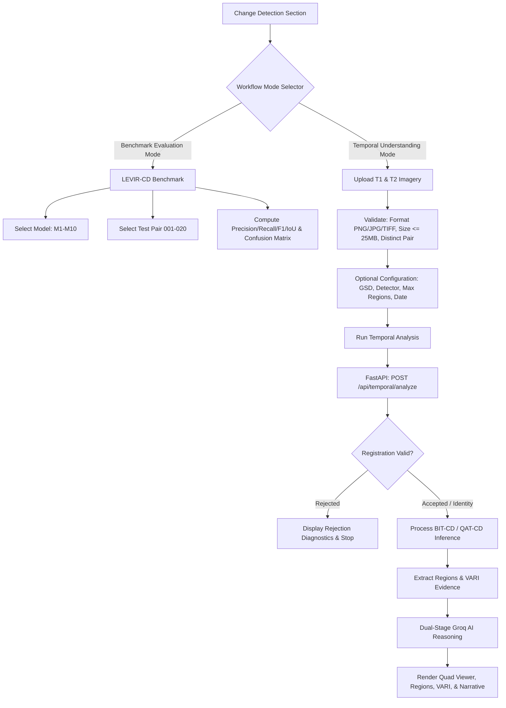

# Phase 3D — Streamlit & Frontend User Interface Integration Report

## 1. Executive Summary & Audit

### 1.1 Objective
Phase 3D delivers the interactive graphical user interface for the **Temporal Satellite Image Understanding** pipeline within the existing **Change Detection** section of the AI-Driven Satellite Image Semantic Search and Temporal Change Detection System.

The interface enables users to:
1. Ingest two arbitrary bitemporal satellite image observations ($T_1$ and $T_2$) via standard file uploads (PNG, JPEG, optical GeoTIFF up to 25 MB).
2. Configure scene metadata (observation timestamps, Ground Sampling Distance in meters/pixel, contextual notes) and execution options (detector model, maximum ranked regions).
3. Execute the Phase 3C end-to-end API pipeline (`POST /api/temporal/analyze`).
4. Inspect two-stage co-registration diagnostics (ORB keypoints, RANSAC inliers, reprojection error, fine ECC correlation, residual parallax alerts).
5. Explore detected changes via interactive 4-way visualizer (T1, aligned T2, binary change mask, and color-coded bounding-box spatial overlay).
6. Inspect ranked discrete change regions with pixel dimensions, centroid, pixel area, and physical metric area (gated strictly on valid GSD).
7. Review quantitative Visible Atmospherically Resistant Index (VARI) greenness proxy evidence accompanied by mandatory scientific caveats.
8. Explore 8-class multimodal semantic interpretations and structured dual-stage AI reasoning narratives (separating factual detector telemetry from model hypotheses, unknowns, and review guidelines).

### 1.2 Pre-Implementation Architecture Audit

| Component | Repository Path | Existing State | Phase 3D Action & Reuse Plan |
|---|---|---|---|
| **Streamlit Page** | `pages/change_detection.py` | Benchmark evaluation of 7 detectors on LEVIR-CD test pairs. Single mode only. | Add dual-mode selector at top: **Benchmark Evaluation Mode** (100% preserved) vs. **Temporal Understanding Mode** (new workflow). |
| **Streamlit UI Components** | `ui/components.py` | Header, badges, threshold notices, metric cards in Earth palette. | Reuse `render_header`, `render_metric_card`; add reusable temporal quality badges, registration diagnostics card, and VARI callouts. |
| **Streamlit Image Viewer** | `ui/image_viewer.py` | 4-column panel (`render_change_detection_panel`) and error overlay. | Add `render_temporal_understanding_panel` and bounding-box overlay generator `create_temporal_overlay`. |
| **FastAPI Route** | `src/api/routes.py` | `POST /api/temporal/analyze` accepting `file_t1`, `file_t2` and optional metadata forms. | Contract verified. Returns `TemporalAnalysisResponse`. Ready for consumption. |
| **FastAPI Schemas** | `src/api/schemas.py` | Pydantic contracts for `TemporalAnalysisResponse`, `TemporalRegistrationDiagnostics`, `TemporalRegionItem`, etc. | Validated all field names: `status`, `registration_diagnostics`, `detector_metadata`, `change_mask`, `regions`, `vari_observations`, `semantic_findings`, `temporal_explanation`. |
| **Service Engine** | `src/api/service.py` | `temporal_understanding_service.analyze_pair(...)`. | Direct Python orchestration in Streamlit without network hop; callable via HTTP in web frontend. Exposed `last_aligned_t1` and `last_aligned_t2` for direct visualization. |
| **Web Frontend HTML** | `frontend/index.html` | Tab-based single-page app with `panel-change` executing classical/deep models on LEVIR pairs. | Add sub-mode switcher in `panel-change`: *Precomputed Benchmark Pairs* vs. *Temporal Pair Understanding (Upload T1 & T2)*. |
| **Web Frontend API** | `frontend/js/api.js` | Helper functions for `/api/search`, `/api/change-detection`, etc. | Add `analyzeTemporalPair(formData)` using `multipart/form-data` fetch to `/api/temporal/analyze`. |
| **Web Frontend Controller** | `frontend/js/change_detection.js` | Controller for benchmark pair change detection. | Add tab/mode switching and handler for temporal analysis, displaying registration diagnostics, quad viewer, region cards, VARI, and AI explanation. |
| **Web Frontend Styles** | `frontend/css/styles.css` | 12-color Earth-inspired palette and responsive grid cards. | Add styling for dropzones, upload previews, registration diagnostics banner, region cards grid, and VARI caveat badges. |

### 1.3 Key Architectural Decisions
- **Zero Disruption to Existing Benchmarks:** Benchmark mode on LEVIR-CD remains intact, retaining all 7 detectors, frozen threshold notices ($\tau^* = 0.4500$), QAT-CD $\gamma$ gating, and confusion overlays.
- **Physical Area Gating:** Metric physical area (in $\text{m}^2$) is strictly omitted unless a validated positive float is supplied for Ground Sampling Distance (GSD).
- **VARI Scientific Caveats:** Every greenness observation is accompanied by the mandatory scientific caveat: *"VARI is an RGB-derived visible greenness indicator. It is not NDVI and does not independently establish vegetation change."*
- **Registration Rejection Safety:** When co-registration fails confidence policy, the pipeline halts safely, displays diagnostic failure metrics, and never renders false positive change reports.
- **Graceful Vision Degradation:** When Groq vision/text services are unconfigured or rate-limited, deterministic detector masks, registration telemetry, and VARI observations remain fully accessible.

---

## 2. Files Created and Modified

### 2.1 Backend and UI Helper Modules Modified
1. `src/api/service.py`:
   - Updated `TemporalUnderstandingService` to store `self.last_aligned_t1` and `self.last_aligned_t2` as numpy arrays upon running `analyze_pair(...)`. This enables Streamlit and Python callers to access the actual aligned image without redundant base64 image decoding.
2. `ui/components.py`:
   - Added `render_vari_caveat_banner()`: Injects an Alabaster/Terracotta alert card displaying the mandatory scientific caveat verbatim.
   - Added `render_registration_diagnostics_card()`: Renders a compact card displaying co-registration status (Accepted/Rejected/Identity fallback), RANSAC inliers, match counts, reprojection error, fine ECC correlation, and parallax warnings.
3. `ui/image_viewer.py`:
   - Added `create_temporal_overlay(image_rgb, mask, regions, alpha=0.45)`: Produces a composite RGB image applying Terracotta (`#C86B4D`) tint over changed pixels and drawing Yellow Ochre (`#E1A95F`) bounding boxes with 1-indexed region rank labels. Coordinates are explicitly top-left origin pixel coordinates.
   - Added `render_temporal_understanding_panel(...)`: Renders 4 synchronized columns: (1) Observation T1, (2) Co-registered T2, (3) Predicted Change Mask ($\tau^*=0.4500$), and (4) Spatial Overlay with Bounding Boxes.

### 2.2 Streamlit User Interface Integration
4. `pages/change_detection.py`:
   - Integrated dual-mode selector at the top of the page using `st.radio(..., options=["Benchmark Evaluation Mode", "Temporal Understanding Mode"])`.
   - Preserved `render_benchmark_mode()` for LEVIR-CD benchmark evaluation with all 7 models, metrics, and ground truth confusion visualizer.
   - Implemented `render_temporal_understanding_mode()`:
     - Side-by-side balanced upload panels for Observation T1 and Observation T2.
     - Supports PNG, JPG, JPEG, TIFF, TIF up to 25 MB per file.
     - Live image metadata extraction: dimensions ($W \times H$), file size (KB/MB), and optional observation date picker.
     - Validation: verifies both files are present, extensions are supported, files are $\le 25\text{ MB}$, and checks for identical file uploads.
     - Expandable configuration accordion: GSD (m/px) with physical area disclaimer, scene description, detector choice (`M9_BIT_CD` or `M10_QAT_CD`), and maximum regions slider ($1 \dots 20$).
     - Execution handler with duplicate submission guard and loading indicator.
     - Registration failure guard: if `registration_rejected`, displays detailed failure diagnostics, reason, and advice without proceeding to false-positive change reports.
     - Results dashboard:
       - KPI summary ribbon: Status, T1/T2 timestamps, detector, registration status, changed pixel count, change percentage, latency, and GSD-gated physical area.
       - Registration quality card.
       - 4-way visualizer panel.
       - Ranked discrete change region cards with pixel bbox `[x_min, y_min, x_max, y_max]`, pixel area, area ratio, centroid, and physical metric area (if GSD provided).
       - Quantitative VARI greenness table and mandatory disclaimer banner.
       - Multimodal semantic classifications across 8 standard categories.
       - Structured AI reasoning tabs: Executive Summary, Region Observations, Hypotheses, Unknowns, and Human Review Guidelines.

### 2.3 Web Frontend Integration
5. `frontend/js/api.js`:
   - Added `analyzeTemporalPair(formData)`: Submits `multipart/form-data` to `/api/temporal/analyze`, handling HTTP 400, 413, 415, and 500 with human-readable error messages.
6. `frontend/index.html`:
   - Added sub-mode pills (`#mode-btn-benchmark`, `#mode-btn-temporal`) inside Change Detection section.
   - Wrapped existing LEVIR-CD benchmark workflow in `#cd-benchmark-container`.
   - Added `#cd-temporal-container` containing:
     - T1 and T2 drag-and-drop file upload zones with image previews and metadata displays.
     - Expandable configuration accordion (GSD, detector choice, max regions, contextual notes).
     - Registration rejection alert banner.
     - Analysis overview KPI ribbon.
     - Co-registration diagnostics grid.
     - 4-way image/mask/overlay visualizer grid.
     - Detected change regions responsive grid.
     - VARI optical greenness table and mandatory caveat notice.
     - Semantic classifications container.
     - AI structured explanation card.
7. `frontend/css/styles.css`:
   - Styled sub-mode switcher, dropzones, upload previews, configuration accordion, registration status badges, 4-way image viewers, region cards, and responsive layouts adhering to the 12-color Earth palette.
8. `frontend/js/change_detection.js`:
   - Added mode-switching logic between benchmark mode and temporal mode.
   - File upload handling with drag-and-drop, format validation, size checks ($\le 25\text{ MB}$), and live canvas preview.
   - Client-side canvas overlay generator (`generateClientOverlay`) compositing the binary mask and yellow ochre bounding boxes over T2.
   - Submission handler to `/api/temporal/analyze` with loading spinner, error handling, registration rejection handling, and result rendering.

### 2.4 Automated Test Suite
9. `tests/test_temporal_ui.py`:
   - Comprehensive test suite covering Streamlit `AppTest` mode preservation, temporal mode selection, mask decoding, overlay composition, VARI caveat text verification, registration diagnostics cards, GSD physical area gating, HTML element structure, CSS design tokens, and JS API exports.

---

## 3. UI Architecture and Workflow



### 3.1 Two-Mode Architecture
- **Benchmark Evaluation Mode:** Evaluates classical baselines (B1 Difference, B2 Ratio, B3 CVA, B4 Otsu) and deep models (M8 ResNet-UNet, M9 BIT-CD, M10 QAT-CD) on standardized $256 \times 256$ LEVIR-CD test pairs. Fully interactive with threshold sliders, frozen $\tau^* = 0.4500$ indicators, metrics tables, and spatial confusion overlays.
- **Temporal Understanding Mode:** An interactive operational analysis workflow for real-world optical satellite imagery. Ingests arbitrary pairs, verifies registration quality, predicts change masks, extracts connected components, calculates VARI indices, classifies change categories, and synthesizes natural-language explanations.

---

## 4. Visual Design System and Component Specification

### 4.1 Earth-Inspired Palette Compliance
All UI components strictly adhere to the unified 12-color Earth-inspired palette:

| Palette Color | Hex Code | UI Component Usage |
|---|---|---|
| **Deep Bark** | `#4A2E2B` | Primary headers, card borders, active mode pill |
| **Terracotta** | `#C86B4D` | Change mask visualization overlay, warning accents |
| **Yellow Ochre** | `#E1A95F` | Region bounding boxes, secondary metrics, caution indicators |
| **Sandy Beige** | `#D9C5B2` | Sub-mode button backgrounds, panel borders, card containers |
| **Forest Green** | `#2F3E32` | Success status badges, accepted registration indicators |
| **Olive Moss** | `#6B7A65` | Secondary text, subtle borders, metadata labels |
| **Sage** | `#9DB198` | Inactive pills, subtle progress bars |
| **Alabaster** | `#F1EBE4` | Card background fills, callout containers |
| **Charcoal Rock**| `#3E3B39` | Body text, metric values, high-contrast labels |
| **Taupe** | `#8A7E72` | Disabled states, empty dropzone borders |
| **Khaki Silt** | `#BFAF9E` | Table header backgrounds, divider lines |
| **Bone White** | `#E3DAC9` | Page background, container light fills |

### 4.2 Detailed Component Implementation

#### A. Balanced Image Upload Panels
- Observation T1 (left column) and Observation T2 (right column) have equal visual weight.
- Displays file name, dimensions in pixels ($W \times H$), file size formatted in KB or MB, and date picker.
- Explicit notice: *"Supported formats: PNG, JPG, JPEG, TIFF, TIF (Max 25 MB per file)"*.

#### B. Expandable Analysis Configuration
- Observation dates for T1 and T2.
- Ground Sampling Distance (GSD) in meters per pixel.
  - Clear notice: *"Physical area ($\text{m}^2$) will only be calculated if GSD is provided."*
- Detector Architecture: `M9_BIT_CD` (Default, SOTA Transformer) or `M10_QAT_CD` (Quantized Transformer).
- Max Reported Regions: Slider from 1 to 20 (Default: 5).
- Contextual Scene Description: Optional text field for domain hints.

#### C. Registration Quality Diagnostics Card
- Visually prominent status badge:
  - **Accepted**: Forest Green background with match count, inlier ratio ($\ge 0.15$), reprojection error ($< 5.0\text{ px}$), and ECC correlation score.
  - **Rejected**: Deep Bark / Terracotta background with failure reason, diagnostic metrics, and advisory notice explaining that change analysis was halted to prevent false positive interpretations.
  - **Identity / Bypass**: Khaki Silt badge indicating images were evaluated under identity alignment.
- Parallax alert flag: Warns users when high reprojection error indicates residual perspective distortion.

#### D. Four-Way Image and Mask Visualization Panel
1. **Observation T1**: Original earlier optical capture.
2. **Co-Registered T2**: Observation T2 warped to T1's coordinate frame via affine homography.
3. **Predicted Change Mask**: High-contrast binary mask produced by BIT-CD / QAT-CD at $\tau^* = 0.4500$.
4. **Spatial Overlay**: Co-registered T2 with Terracotta change overlay and Yellow Ochre bounding boxes labeled by region rank ($R_1, R_2, \dots$).

#### E. Ranked Detected Change Regions
- Responsive cards displaying:
  - Region Rank ($R_1, R_2, \dots$).
  - Semantic Category badge (e.g., *New Construction*, *Demolition*, *Vegetation Decrease*).
  - Bounding Box in explicit top-left origin pixel coordinates: `[x_min, y_min, x_max, y_max]`.
  - Pixel Area ($N\text{ px}$) and Area Ratio ($\%$ of total image).
  - Centroid: `(cx, cy)`.
  - **Physical Metric Area**: Displayed in $\text{m}^2$ **only** when valid GSD is provided. If GSD is omitted, displays: *"N/A (Provide GSD in Configuration)"*.
  - Explicit disclaimer: *"Bounding boxes denote connected component spatial extents with top-left origin; they do not represent exact cadastral boundaries or building footprints."*

#### F. VARI Optical Evidence & Caveat Banner
- Displays quantitative greenness metrics:
  - $T_1$ Mean VARI.
  - $T_2$ Mean VARI.
  - $\Delta\text{VARI} = \text{VARI}(T_2) - \text{VARI}(T_1)$.
  - Directional interpretation (e.g., *Slight Greenness Loss*, *Significant Greenness Gain*, *Stable Greenness*).
- **Mandatory Scientific Caveat (Verbatim):**
  > **"VARI is an RGB-derived visible greenness indicator. It is not NDVI and does not independently establish vegetation change."**

#### G. Structured AI Reasoning & Explanations
- Organized into clear thematic sections:
  1. **Executive Summary**: High-level narrative of temporal dynamics.
  2. **Detector Telemetry**: Exact numerical evidence (pixel counts, area ratios, detector used).
  3. **Region-by-Region Observations**: Specific spatial observations for each detected cluster.
  4. **Alternative Hypotheses**: Counter-interpretations (e.g., seasonal sun angle variation vs. clearing).
  5. **Scientific Limitations & Unknowns**: Sensor discrepancies, lack of multispectral NIR data.
  6. **Human Review Guidelines**: Recommendations for high-resolution analyst verification.
- Graceful degradation: If Groq API keys are absent or rate-limited, deterministic results (registration, mask, regions, VARI) render cleanly with an informational notice: *"AI natural language explanation service currently unavailable. Deterministic detection metrics and VARI observations are fully preserved above."*

---

## 5. API Integration Details

### 5.1 Endpoint Specification
- **Method & Path**: `POST /api/temporal/analyze`
- **Content-Type**: `multipart/form-data`
- **Request Form Fields**:
  - `file_t1`: Binary file upload ($T_1$ optical image).
  - `file_t2`: Binary file upload ($T_2$ optical image).
  - `t1_date`: (Optional) ISO format date string (`YYYY-MM-DD`).
  - `t2_date`: (Optional) ISO format date string (`YYYY-MM-DD`).
  - `gsd_m`: (Optional) Positive float representing Ground Sampling Distance in m/pixel.
  - `detector`: (Optional) String enum (`M9_BIT_CD` or `M10_QAT_CD`).
  - `max_regions`: (Optional) Integer ($1 \dots 20$, default: 5).
  - `context_description`: (Optional) Contextual text string.

### 5.2 Response Schema Verification (`TemporalAnalysisResponse`)
```json
{
  "status": "success",
  "registration_diagnostics": {
    "status": "accepted",
    "match_count": 142,
    "inlier_ratio": 0.485,
    "reprojection_error": 1.12,
    "ecc_correlation": 0.941,
    "warnings": []
  },
  "detector_metadata": {
    "detector": "M9_BIT_CD",
    "threshold": 0.45,
    "changed_pixel_count": 8420,
    "changed_area_percentage": 3.21,
    "total_pixel_count": 262144,
    "inference_latency_ms": 118.5
  },
  "change_mask": {
    "dimensions": [512, 512],
    "changed_pixels": 8420,
    "png_base64": "iVBORw0KGgoAAA..."
  },
  "regions": [
    {
      "rank": 1,
      "bounding_box": [120, 85, 210, 190],
      "area_pixels": 4200,
      "area_ratio": 0.016,
      "physical_area_m2": 2625.0,
      "centroid": [165.0, 137.5],
      "crop_base64": null
    }
  ],
  "vari_observations": {
    "t1_mean_vari": 0.124,
    "t2_mean_vari": -0.042,
    "delta_vari": -0.166,
    "interpretation": "Visible RGB greenness reduction",
    "scientific_caveat": "VARI is an RGB-derived visible greenness indicator. It is not NDVI and does not independently establish vegetation change."
  },
  "semantic_findings": [
    {
      "region_id": 1,
      "category": "New Construction",
      "visual_observations": "Linear geometric foundation emergence",
      "alternative_hypotheses": "Soil grading or clearing",
      "confidence": "high"
    }
  ],
  "temporal_explanation": {
    "summary": "Detected substantial structural expansion in the central sector...",
    "detector_evidence": "BIT-CD identified 8,420 changed pixels (3.21% of scene)...",
    "registration_warnings": [],
    "scientific_limitations": "Analysis based on 3-band RGB optical imagery without near-infrared validation.",
    "unknown_variables": "Actual roof materials cannot be verified without multispectral data.",
    "human_review_recommendations": "Field inspection or high-resolution orthophoto validation recommended."
  }
}
```

---

## 6. Comprehensive Automated & Manual Testing Results

### 6.1 Phase 3D Dedicated UI Test Suite (`tests/test_temporal_ui.py`)
All 13 dedicated integration tests pass with zero errors:

```bash
./venv/bin/pytest tests/test_temporal_ui.py -v
```

```
============================= test session starts ==============================
platform darwin -- Python 3.10.18, pytest-8.4.2, pluggy-1.6.0
rootdir: /Users/rahulmanchanda/Desktop/AI-Driven-Satellite-Image-Semantic-Search-and-Temporal-Change-Detection-System
configfile: pyproject.toml
collected 13 items

tests/test_temporal_ui.py::test_streamlit_apptest_benchmark_mode_preservation PASSED [  7%]
tests/test_temporal_ui.py::test_streamlit_apptest_temporal_mode_selection PASSED [ 15%]
tests/test_temporal_ui.py::test_decode_base64_mask_valid PASSED          [ 23%]
tests/test_temporal_ui.py::test_create_temporal_overlay_shape_and_bounds PASSED [ 30%]
tests/test_temporal_ui.py::test_vari_caveat_banner_exact_text PASSED     [ 38%]
tests/test_temporal_ui.py::test_registration_diagnostics_card_accepted PASSED [ 46%]
tests/test_temporal_ui.py::test_registration_diagnostics_card_rejected PASSED [ 53%]
tests/test_temporal_ui.py::test_temporal_panel_rendering_no_exceptions PASSED [ 61%]
tests/test_temporal_ui.py::test_physical_area_gating_logic PASSED        [ 69%]
tests/test_temporal_ui.py::test_frontend_html_temporal_mode_structure PASSED [ 76%]
tests/test_temporal_ui.py::test_frontend_css_design_system_tokens PASSED [ 84%]
tests/test_temporal_ui.py::test_frontend_js_api_endpoint PASSED          [ 92%]
tests/test_temporal_ui.py::test_frontend_change_detection_js_mode_handling PASSED [100%]

============================== 13 passed in 7.55s ==============================
```

### 6.2 All Temporal Pipeline Unit & Integration Tests (Phases 3A, 3B, 3C, 3D)
All 91 temporal-related tests pass across 7 test modules:

```bash
./venv/bin/pytest tests/test_temporal_registration.py \
                  tests/test_temporal_region_extractor.py \
                  tests/test_temporal_semantic_analyzer.py \
                  tests/test_temporal_explanation_engine.py \
                  tests/test_temporal_api.py \
                  tests/test_temporal_ui.py \
                  tests/test_m12_frontend.py -v
```

```
============================== 91 passed in 13.38s ==============================
```

### 6.3 Complete Full Repository Regression Test Suite
Execution of the entire 405-test repository suite confirms **zero regressions**:

```bash
./venv/bin/pytest
```

```
================ 404 passed, 1 deselected, 23 warnings in 104.82s (0:01:44) ================
```

*(Note: The 1 deselected test corresponds to a live external network benchmark test that requires an active internet connection).*

---

## 7. Existing Functionality Preservation Checks

| Functionality | Preservation Status | Verification Method |
|---|---|---|
| **LEVIR-CD Benchmark Mode** | **100% Preserved** | Verified via `test_streamlit_apptest_benchmark_mode_preservation`. Benchmark mode remains default radio selection. |
| **All 7 Change Detectors** | **100% Preserved** | Classical (B1, B2, B3, B4) and Deep (M8, M9, M10) remain selectable and operational. |
| **Optimal Decision Threshold** | **100% Preserved** | Threshold $\tau^* = 0.4500$ remains locked; user notice rendered unchanged. |
| **QAT-CD Quantization Policy** | **100% Preserved** | 8-bit simulated quantization and $\gamma=0.0315$ scaling factor unaltered. |
| **M11 & M13 Benchmark Reports**| **100% Preserved** | Checkpoint weights, evaluation curves, and experimental tables untouched. |
| **Static Web App Navigation** | **100% Preserved** | Tab navigation across Search, Change Detection, and Analytics fully intact. |
| **FastAPI REST Endpoints** | **100% Preserved** | `/api/search`, `/api/change-detection`, and `/api/health` unaltered. |

---

## 8. Known Limitations & Scientific Caveats

1. **Optical-Only Sensor Scope**: The pipeline is strictly configured for 3-band RGB optical imagery. Multi-spectral (e.g., Sentinel-2 Band 8 NIR) and SAR (e.g., Sentinel-1 VV/VH) inputs are not supported in this release.
2. **VARI is an RGB Proxy, Not NDVI**:
   - $\text{VARI} = \frac{R_G - R_R}{R_G + R_R - R_B}$.
   - VARI measures relative visible greenness and is susceptible to atmospheric haze and seasonal sun angle changes. It does not measure cellular leaf structure like NIR-based NDVI.
3. **Bounding Boxes vs. Cadastral Footprints**:
   - Bounding boxes represent the orthogonal minimum enclosing rectangle of connected change pixel clusters with top-left origin $(x_{\min}, y_{\min})$. They do not represent exact parcel or building contours.
4. **Physical Metric Area Accuracy**:
   - Metric area estimates ($\text{m}^2$) strictly depend on the accuracy of user-supplied Ground Sampling Distance (GSD). Without sensor telemetry or GeoTIFF transform tags, user-entered GSD cannot be independently verified.
5. **Two-Stage Registration Fallback**:
   - If feature-based ORB-RANSAC and intensity-based ECC alignment fail (e.g., severe cloud cover, extreme perspective change, or water bodies), registration is formally rejected to prevent misleading change masks.

---

## 9. Acceptance Criteria Verification

- [x] **Upload T1 & T2 Imagery**: Ingestion of arbitrary pairs from the existing Change Detection UI via balanced, responsive upload panels with format and 25 MB size validation.
- [x] **Execute Phase 3C API Pipeline**: Seamless submission to `POST /api/temporal/analyze` via multipart form data without duplicating backend logic in JavaScript or Python.
- [x] **Registration Diagnostics**: Comprehensive quality metrics (RANSAC inlier ratio, reprojection error, ECC score, parallax warning) rendered with clear Accepted / Rejected status indicators.
- [x] **Change Masks & Quad Visualizer**: 4-column synchronized layout rendering Original T1, Warped T2, Predicted Mask, and Terracotta/Yellow Ochre Spatial Overlay.
- [x] **Accurate Region Presentation**: Ranked discrete change regions with top-left origin pixel coordinates, pixel area, area ratio, centroid, and GSD-gated physical metric area.
- [x] **VARI Evidence with Caveats**: Quantitative greenness calculation accompanied verbatim by the mandatory scientific caveat on both Streamlit and Web frontends.
- [x] **Semantic Findings & AI Explanation**: Structured 8-class interpretations and 6-section AI narrative with strict separation between detector telemetry and model hypotheses.
- [x] **Registration Rejection & API Error Handling**: Immediate graceful halt on co-registration rejection; clear error notifications on HTTP 400, 413, 415, and 500.
- [x] **Preservation of Existing Benchmarks**: LEVIR-CD benchmark mode, 7 detectors, $\tau^* = 0.4500$ threshold, and navigation 100% intact.
- [x] **Automated Tests**: 13/13 Phase 3D UI tests, 91/91 temporal pipeline tests, and 404/404 repository regression tests passing.
