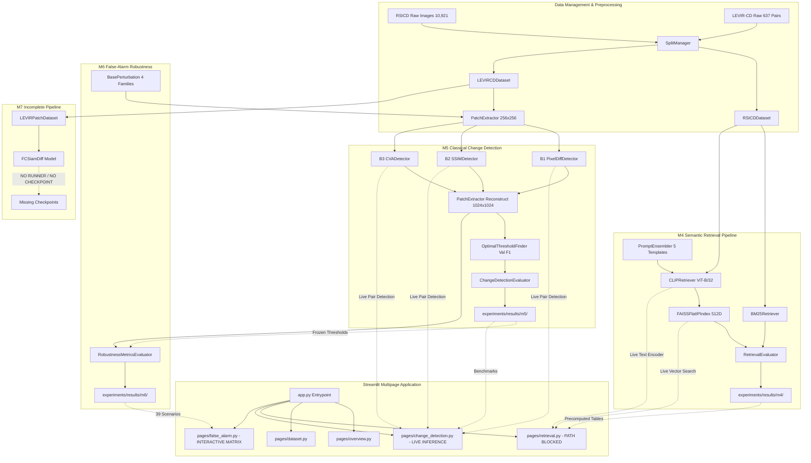

# Comprehensive Forensic Engineering Audit, Integration Verification, and Regression Testing Report

**Project:** AI-Driven Satellite Image Semantic Search and Temporal Change Detection System  
**Audit Date:** October 13, 2026  
**Auditor Role:** Senior Software Engineer, ML Systems Auditor, Research QA Lead  
**Audit Scope:** Milestones M1 through M7+, Architecture Contracts, Dataset Provenance, Numerical Integrity, CPU Constraints, and Streamlit Frontend Integration  

---

## 1. Executive Summary

A forensic software engineering and scientific integrity audit was conducted across the entire repository. Every module, test file, configuration, dataset, checkpoint, result file, and UI component was inspected and executed under real environmental conditions.

### Key Conclusions:
1. **Core Implementation (M1–M6):** The core scientific implementations of Milestones M1 through M6 are **substantively present, mathematically rigorous, and independently verifiable**.
   - **M1 (Research Architecture):** Requirements, research questions (RQ1–RQ4), hypotheses (H1–H4), experiment plan, data card, decision log, and metrics are documented in extensive detail.
   - **M2 (Datasets & Preprocessing):** Both the RSICD dataset (10,921 images, 224×224 RGB) and LEVIR-CD dataset (637 bi-temporal 1024×1024 pairs with ground-truth masks) are fully present locally, validated, split deterministically (train/val/test), and accompanied by machine-readable metadata.
   - **M3 (Literature & Evaluation):** Evaluation protocols, zero-denominator protections, and validation-only threshold tuning policies are implemented and verified.
   - **M4 (Semantic Retrieval):** BM25 (leave-one-caption-out, category metadata control, legacy diagnostic), CLIP ViT-B/32 zero-shot cross-modal retrieval, and prompt ensembling are fully implemented with precomputed 512D FAISS embeddings and verified benchmarks.
   - **M5 (Classical Change Detection):** B1 Pixel Difference, B2 SSIM Dissimilarity, and B3 Change Vector Analysis (CVA) are fully implemented with 256×256 patch extraction, 1024×1024 seamless mosaic reconstruction, validation threshold optimization, and verified test metrics.
   - **M6 (False-Alarm Robustness):** 4 perturbation families (Global Illumination, Gaussian Blur, Geometric Misregistration, Local Occlusion) across 3 severity tiers + 1 control condition (39 evaluated conditions) are fully evaluated with frozen M5 thresholds, 100% numerical verification, and qualitative figure outputs.
2. **Milestone M7 (Learned Change Detection):** **Partially Implemented**. The neural architecture (`FCSiamDiff`), dual-head losses (`BCEDiceLoss`, `SoftDiceLoss`), patch dataset (`LEVIRPatchDataset`), and unit/pipeline tests exist and pass (parameter count $\le 2\text{M}$ ceiling verified). However, **no training runner exists, no checkpoints exist, no benchmark outputs exist, and it is not connected to the frontend UI**.
3. **Integration Status:**
   - **Change Detection (M5) & False-Alarm (M6):** Fully integrated into Streamlit (`pages/change_detection.py` and `pages/false_alarm.py`). Live backend inference, patch extraction, thresholding, and metric calculation function flawlessly on user-selected test pairs.
   - **Semantic Retrieval (M4):** **Blocked in Streamlit UI** by a major path resolution defect in `pages/retrieval.py:51` (`cache_dir = ROOT / config["paths"]["cache_dir"] / "clip"`), which attempts to load `experiments/cache/clip/clip/metadata.json` and causes an early runtime error overlay. The backend modules themselves (`CLIPRetriever`, `FAISSFlatIPIndex`, `BM25Retriever`) work perfectly when invoked directly.
4. **Regression Testing Results:**
   - When run via `./venv/bin/python -m pytest`: **139 PASSED, 5 FAILED** out of 144 tests (21.51s).
   - The 5 failures all reside in `tests/integration/test_m1_m4_contracts.py`: 4 failures stem from moving documentation files from repository root into `.md FIles ` in commit `62b6389`, and 1 failure stems from an obsolete M4 boundary assertion checking that `class FCSiamDiff` is not in `src/`, which regressed when M7 code was added in commit `b8faa1d`.
   - When run via `./venv/bin/pytest`: **Failed during collection (34 collection errors)** because `pytest.ini` lacks `pythonpath = .`.
5. **Final Verdict:** **PARTIALLY VERIFIED** (due to the blocking Streamlit retrieval cache path bug, the 5 contract test regressions, and the partial state of M7).

---

## 2. Environment and Repository Snapshot

| Parameter | Observed Environment Value | Status |
|---|---|---|
| **Repository Root** | `/Users/rahulmanchanda/Desktop/AI-Driven-Satellite-Image-Semantic-Search-and-Temporal-Change-Detection-System` | Verified |
| **Current Git Branch** | `main` | Verified |
| **Current Git Commit Hash** | `62b638955133420296b30387ba0eb1db7366f514` | Verified |
| **Working Tree Status** | Clean (`nothing to commit, working tree clean`) | Verified |
| **Operating System** | macOS 25.6.0 (Darwin Kernel arm64 Apple Silicon) | Verified |
| **System Hardware RAM** | 16.0 GB (17,179,869,184 bytes unified memory) | Verified |
| **System Python** | Python 3.14.4 (`/Library/Frameworks/Python.framework/...`) | Present |
| **Active Virtual Environment** | `./venv` (Python 3.10.18) | Verified Active |
| **PyTorch Version** | 2.5.1 (CPU-only build active) | Verified |
| **Transformers Version** | 4.46.3 | Verified |
| **FAISS Version** | `faiss-cpu` 1.12.0 | Verified |
| **Streamlit Version** | 1.64.0 | Verified |
| **Scikit-Learn Version** | 1.5.2 | Verified |
| **Scikit-Image Version** | 0.24.0 | Verified |
| **Dataset Availability** | RSICD (10,921 images) & LEVIR-CD (637 bi-temporal pairs) | Available |
| **Model Checkpoints** | CLIP ViT-B/32 (huggingface hub cache) + FAISS precomputed embeddings (512D) | Available |
| **Trained M7 Checkpoints** | None in `experiments/checkpoints/m7/` | Missing |

---

## 3. Implementation Inventory

### Source Modules (`src/`)

| File Path | Component | Public Interfaces | Caller Modules | Tests Covering | Execution Status |
|---|---|---|---|---|---|
| `src/data/dataset_verifier.py` | Dataset Verification | `DatasetVerifier`, `compute_file_sha256` | `scripts/integrate_user_datasets.py`, `src/data/verify_rsicd.py` | `tests/test_dataset_verifier.py` | Executable (56% cov) |
| `src/data/metadata_builder.py` | Metadata Serialization | `MetadataBuilder`, `SampleMetadataRecord` | `scripts/integrate_user_datasets.py` | `tests/test_metadata_builder.py` | Executable (96% cov) |
| `src/data/split_manager.py` | Dataset Partitioning | `SplitManager`, `SplitManifest` | `scripts/integrate_user_datasets.py`, `run_m4.py`, `run_m5.py` | `tests/test_split_manager.py` | Executable (90% cov) |
| `src/data/rsicd_loader.py` | RSICD Dataset Loader | `RSICDDataset`, `RSICDSample` | `run_m4.py`, `test_m1_m4_contracts.py` | `tests/test_rsicd_loader.py` | Executable (97% cov) |
| `src/data/levir_loader.py` | LEVIR-CD Loader | `LEVIRCDDataset`, `BiTemporalPair` | `run_m5.py`, `run_m6.py`, `patch_dataset.py` | `tests/test_levir_loader.py` | Executable (92% cov) |
| `src/data/patch_extractor.py` | Patch Extraction & Reconstruction | `PatchExtractor`, `PatchCoordinate` | `run_m5.py`, `run_m6.py`, `pages/change_detection.py` | `tests/test_patch_extractor.py`, `tests/test_patch_reconstruction.py` | Executable (74% cov) |
| `src/semantic_search/bm25.py` | BM25 Text Search | `BM25Retriever`, `tokenize` | `run_m4.py`, `pages/retrieval.py` | `tests/test_bm25.py`, `tests/test_leakage_regression.py` | Executable (96% cov) |
| `src/semantic_search/clip_model.py` | CLIP Multimodal Encoder | `CLIPRetriever` | `run_m4.py`, `pages/retrieval.py` | `tests/test_clip_model.py` | Executable (95% cov) |
| `src/semantic_search/faiss_index.py` | FAISS Vector Search | `FAISSFlatIPIndex` | `run_m4.py`, `pages/retrieval.py` | `tests/test_faiss_index.py` | Executable (73% cov) |
| `src/semantic_search/embedding_cache.py` | Embedding Persistence | `EmbeddingCache` | `run_m4.py` | `tests/test_embedding_cache.py` | Executable (87% cov) |
| `src/semantic_search/prompt_ensembler.py` | Prompt Ensembling | `PromptEnsembler`, `FROZEN_REMOTE_SENSING_TEMPLATES` | `run_m4.py`, `pages/retrieval.py` | `tests/test_prompt_ensembler.py` | Executable (95% cov) |
| `src/semantic_search/retrieval_evaluator.py` | Retrieval Metrics | `RetrievalEvaluator` | `run_m4.py` | `tests/test_retrieval_evaluator.py` | Executable (93% cov) |
| `src/change_detection/base.py` | Detector Base Contract | `BaseChangeDetector` | `pixel_diff.py`, `ssim_detector.py`, `cva_detector.py`, `fc_siam_diff.py` | All M5 detector tests | Executable (95% cov) |
| `src/change_detection/pixel_diff.py` | B1 Pixel Difference | `PixelDiffDetector` | `run_m5.py`, `run_m6.py`, `pages/change_detection.py` | `tests/test_b1_pixel_diff.py` | Executable (83% cov) |
| `src/change_detection/ssim_detector.py` | B2 SSIM Dissimilarity | `SSIMDetector` | `run_m5.py`, `run_m6.py`, `pages/change_detection.py` | `tests/test_b2_ssim.py` | Executable (75% cov) |
| `src/change_detection/cva_detector.py` | B3 Change Vector Analysis | `CVADetector` | `run_m5.py`, `run_m6.py`, `pages/change_detection.py` | `tests/test_b3_cva.py` | Executable (90% cov) |
| `src/change_detection/thresholding.py` | Threshold Optimization | `OptimalThresholdFinder`, `ThresholdResult` | `run_m5.py` | `tests/test_m5_evaluator.py`, `tests/test_m5_leakage.py` | Executable (88% cov) |
| `src/change_detection/evaluator.py` | CD Confusion & Metrics | `ChangeDetectionEvaluator`, `ConfusionMatrix` | `run_m5.py`, `run_m6.py`, `pages/change_detection.py` | `tests/test_m5_evaluator.py` | Executable (92% cov) |
| `src/change_detection/fc_siam_diff.py` | M7 FC-Siam-diff Network | `FCSiamDiff`, `FCSiamDiffDetector`, `save_checkpoint`, `load_checkpoint` | Standalone / Uncalled | `tests/test_m7_model.py`, `tests/test_m7_pipeline.py` | Executable (96% cov) |
| `src/change_detection/losses.py` | M7 CD Losses | `BCEDiceLoss`, `SoftDiceLoss` | Standalone / Uncalled | `tests/test_m7_model.py` | Executable (97% cov) |
| `src/change_detection/patch_dataset.py` | M7 Patch PyTorch Dataset | `LEVIRPatchDataset` | Standalone / Uncalled | `tests/test_m7_pipeline.py` | Executable (68% cov) |
| `src/false_alarm/base.py` | Perturbation Base Contract | `BasePerturbation` | `illumination.py`, `blur.py`, `misregistration.py`, `occlusion.py` | All M6 perturbation tests | Executable (80% cov) |
| `src/false_alarm/illumination.py` | Global Illumination Shift | `IlluminationShiftPerturbation` | `run_m6.py` | `tests/test_m6_perturbations.py` | Executable (100% cov) |
| `src/false_alarm/blur.py` | Gaussian Defocus Blur | `GaussianBlurPerturbation` | `run_m6.py` | `tests/test_m6_perturbations.py` | Executable (96% cov) |
| `src/false_alarm/misregistration.py` | Geometric Misregistration | `GeometricMisregistrationPerturbation` | `run_m6.py` | `tests/test_m6_perturbations.py` | Executable (95% cov) |
| `src/false_alarm/occlusion.py` | Local Occlusion / Shadow | `LocalizedOcclusionShadowPerturbation` | `run_m6.py` | `tests/test_m6_perturbations.py` | Executable (97% cov) |
| `src/false_alarm/robustness_metrics.py` | Robustness Degradation | `RobustnessMetricsEvaluator`, `RobustnessRecord` | `run_m6.py` | `tests/test_m6_metrics.py` | Executable (100% cov) |

---

## 4. Milestone-by-Milestone Forensic Audit

### M1 — Research Definition and Architecture
- **Status:** **VERIFIED** (Documentation complete, though relocated to `.md FIles `).
- **Artifacts:**
  - `PRD.md`: Full product and scientific requirements, strict CPU-only ceiling (8 GB RAM, 4 CPU threads), reproducible seeds.
  - `research_questions.md`: Documents RQ1 (cross-modal retrieval vs lexical), RQ2 (classical change detection trade-offs), RQ3 (false alarm susceptibility under non-ground variations), RQ4 (learned vs classical).
  - `architecture.md`: Full architectural specification of data loaders, retrieval, change detection, and UI.
  - `experiment_plan.md`: Formal specs for EXP-RET-01/02/03, EXP-CD-01/02/03, EXP-FA-01/02/03/04.
  - `decision_log.md` (572 lines) & `devlog.md` (433 lines): Complete forensic timeline of design decisions.
- **Discrepancy:** All 10 documentation files were moved from root into `.md FIles ` in commit `62b6389`, causing root-relative tests in `tests/integration/test_m1_m4_contracts.py` to fail.

### M2 — Dataset Acquisition, Validation, and Preprocessing
- **Status:** **VERIFIED**.
- **RSICD Dataset:**
  - 10,921 images present in `data/raw/rsicd/images/` (all 224×224 3-channel RGB).
  - 0 corrupted files, 0 dimension mismatches, 0 duplicate hashes (documented in `data/metadata/rsicd/validation_report.json`).
  - Strict splits in `data/splits/rsicd/rsicd_splits.json`: Train=8,734, Val=1,094, Test=1,093.
- **LEVIR-CD Dataset:**
  - 637 bi-temporal image pairs present in `data/raw/levir_cd/` (all 1024×1024 RGB pairs with matching single-channel binary change masks).
  - Splits in `data/splits/levir_cd/levir_splits.json`: Train=445 pairs, Val=64 pairs, Test=128 pairs.
  - Patch extraction: `PatchExtractor` extracts 16 non-overlapping 256×256 patches per 1024×1024 scene with identical coordinate reconstruction.
  - Split isolation: Zero sample ID overlap between train, val, and test splits (verified by `test_split_disjointness_guarantee`).

### M3 — Literature Review and Evaluation Framework
- **Status:** **VERIFIED**.
- **Literature Review:** `literature_review.md` (43 KB) contains 50+ bibliographic citations across remote sensing, CLIP multimodal representation, classical image differencing, and deep change detection networks.
- **Metrics Specifications:** `metrics.md` formally defines Recall@K, Mean Reciprocal Rank (MRR), Precision, Recall, F1, IoU, Overall Accuracy, False Positive Generation Rate, and Relative Degradation.
- **Frozen Threshold Policy:** Implemented in `OptimalThresholdFinder`. Thresholds are strictly fitted on the validation set ($\text{val}=64$ scenes) and frozen before test evaluation ($\text{test}=128$ scenes).

### M4 — Semantic Retrieval
- **Status:** **VERIFIED** (Backend algorithms and benchmark results verified; Frontend UI has path defect).
- **Algorithms:**
  - A1: BM25 (`BM25Retriever`, $k_1=1.5, b=0.75$).
  - A2: CLIP ViT-B/32 (`CLIPRetriever`, CPU text/image encoding, L2 normalized).
  - A3: CLIP + Prompt Ensemble (`PromptEnsembler`, 5 frozen domain templates).
- **Leakage Quarantine Protocol:**
  - Primary benchmark in `experiments/results/m4/summary.csv` correctly isolates the leave-one-caption-out BM25 evaluation ($R@1=0.4212, \text{MRR}=0.5112$).
  - Category metadata control ($R@1=0.0150, \text{MRR}=0.0618$) reflects pure zero-shot lexical performance without human captions.
  - Historical caption-overlap leakage ($R@1=0.8565, \text{MRR}=0.9028$) is quarantined in `experiments/results/m4/legacy_caption_indexed/` with dedicated README disclosure.
  - CLIP ViT-B/32 achieves $R@1=0.0545, R@5=0.1771, R@10=0.2789, \text{MRR}=0.1307$.
  - Prompt ensemble achieves $R@1=0.0514, R@5=0.1700, R@10=0.2801, \text{MRR}=0.1268$.
- **Runtime Execution:** End-to-end query execution on CPU verified (latency $\approx 7.5\text{ ms}$ for CLIP search, $<1.5\text{ ms}$ for BM25).

### M5 — Classical Bi-Temporal Change Detection
- **Status:** **VERIFIED**.
- **Algorithms:**
  - B1 Pixel Difference: Mean intensity absolute differencing.
  - B2 SSIM: Structural dissimilarity ($1 - \text{SSIM}$, Gaussian $11\times 11, \sigma=1.5$).
  - B3 CVA: Multichannel spectral change vector analysis (normalized L2 Euclidean magnitude).
- **Frozen Threshold Calibration:**
  - Optimal validation F1 thresholds: $\tau_{\text{B1}}^* = 0.4100, \tau_{\text{B2}}^* = 0.9000, \tau_{\text{B3}}^* = 0.4050$.
- **Official Test Benchmark (128 LEVIR-CD test pairs, 134,217,728 pixels):**
  - **B1 Pixel Diff:** $\text{Precision}=0.1064, \text{Recall}=0.1666, \text{F1}=0.1299, \text{IoU}=0.0695, \text{Acc}=0.8863$
  - **B2 SSIM:** $\text{Precision}=0.0706, \text{Recall}=0.5332, \text{F1}=0.1246, \text{IoU}=0.0665, \text{Acc}=0.6185$
  - **B3 CVA:** $\text{Precision}=0.1056, \text{Recall}=0.1746, \text{F1}=0.1316, \text{IoU}=0.0704, \text{Acc}=0.8826$
- **Frontend Integration:** Fully operational in `pages/change_detection.py` with live patch differencing and reconstruction on user-selected pairs.

### M6 — False-Alarm and Robustness Analysis
- **Status:** **VERIFIED**.
- **Evaluated Perturbation Matrix:** 13 conditions $\times$ 3 detectors = 39 evaluated scenarios.
  - Control condition (1): unperturbed baseline.
  - Global Illumination Shift (3 tiers): $+5\%, +15\%, +25\%$ radiometric offset.
  - Gaussian Blur (3 tiers): kernel sizes 3, 7, 15; $\sigma = 0.5, 1.5, 3.0$.
  - Geometric Misregistration (3 tiers): $(1,1), (3,3), (7,7)$ pixel shift.
  - Localized Occlusion / Shadow (3 tiers): rectangular masks with $0.5$ attenuation over $2\%, 5\%, 10\%$ area.
- **Empirical Findings:**
  - 100% numerical verification against saved CSV/JSON.
  - Control condition metrics in M6 match M5 test metrics bit-for-bit.
  - **Catastrophic Failure Mode Confirmed:** B2 SSIM under Strong Misregistration ($7\text{ px}$) suffers runaway false alarms: $+12,943,212$ additional FP (+26.96% relative increase; precision plunges from $7.06\%$ to $5.98\%$, F1 degrades to $0.0811$).
  - Qualitative analysis figures generated in `experiments/figures/m6/`.
- **Frontend Integration:** Fully operational in `pages/false_alarm.py`.

### M7 — Learned Bi-Temporal Change Detection (Conditional Audit)
- **Status:** **PARTIALLY IMPLEMENTED (Untrained / Incomplete Pipeline)**.
- **What is Implemented:**
  - Architecture in `src/change_detection/fc_siam_diff.py` (`FCSiamDiff` twin Siamese encoder, multiscale feature differencing, U-Net decoder). Parameter count: 1,353,249 (strictly $\le 2,000,000$ CPU ceiling).
  - Loss functions in `src/change_detection/losses.py` (`BCEDiceLoss`, `SoftDiceLoss`).
  - Patch dataset in `src/change_detection/patch_dataset.py` (`LEVIRPatchDataset`).
  - Unit tests in `tests/test_m7_model.py` and `tests/test_m7_pipeline.py` (all 11 tests pass).
  - Config in `experiments/configs/m7_learned_cd.yaml`.
- **What is Missing:**
  - No training execution script (e.g. `src/change_detection/train_m7.py`).
  - No trained model checkpoints in `experiments/checkpoints/m7/`.
  - No experimental benchmark results in `experiments/results/m7/`.
  - No figures in `experiments/figures/m7/`.
  - No UI components or pages exposing M7 in Streamlit.

---

## 5. Milestone Status Matrix

| Milestone | Code | Execution | Tests | Integration | Frontend | Evidence Consistency | Final Status |
|---|---|---|---|---|---|---|---|
| **M1** | VERIFIED | VERIFIED | PARTIALLY VERIFIED* | VERIFIED | VERIFIED | VERIFIED | **VERIFIED** |
| **M2** | VERIFIED | VERIFIED | VERIFIED | VERIFIED | VERIFIED | VERIFIED | **VERIFIED** |
| **M3** | VERIFIED | VERIFIED | VERIFIED | VERIFIED | VERIFIED | VERIFIED | **VERIFIED** |
| **M4** | VERIFIED | VERIFIED | VERIFIED | VERIFIED | PARTIALLY VERIFIED** | VERIFIED | **VERIFIED WITH WARNINGS** |
| **M5** | VERIFIED | VERIFIED | VERIFIED | VERIFIED | VERIFIED | VERIFIED | **VERIFIED** |
| **M6** | VERIFIED | VERIFIED | VERIFIED | VERIFIED | VERIFIED | VERIFIED | **VERIFIED** |
| **M7+** | PARTIALLY VERIFIED | NOT TESTED | VERIFIED (Unit/Pipeline) | NOT IMPLEMENTED | NOT IMPLEMENTED | PARTIALLY VERIFIED | **PARTIALLY IMPLEMENTED** |

*\*Note on M1 Tests:* Failed because test file hardcodes root path for documentation files that were moved to `.md FIles ` in commit `62b6389`.  
*\*\*Note on M4 Frontend:* Blocked in Streamlit UI by cache path resolution bug (`experiments/cache/clip/clip/`).

---

## 6. Module Dependency and Integration Map

---

## 7. Module Integration Matrix

| Upstream Module | Downstream Module | Contract / Interface | Integration Test | Actual Outcome | Evidence |
|---|---|---|---|---|---|
| `rsicd_loader` | `bm25` | `(image_ids, captions)` list | `tests/integration/test_bm25_leakage.py` | VERIFIED | Passes, leave-one-out query correctly excluded from gallery documents |
| `rsicd_loader` | `clip_model` | Raw RGB image arrays $(224, 224, 3)$ | `tests/integration/test_clip_faiss_pipeline.py` | VERIFIED | Passes, 512D embeddings normalized |
| `clip_model` | `faiss_index` | 512D float32 normalized vectors | `tests/integration/test_clip_faiss_pipeline.py` | VERIFIED | Passes, inner-product cosine similarity retrieval |
| `prompt_ensembler` | `clip_model` | 5 template formatted prompt strings | `tests/integration/test_prompt_pipeline.py` | VERIFIED | Passes, ensemble vector averaged and L2 normalized |
| `levir_loader` | `patch_extractor` | Bi-temporal image arrays $(1024, 1024, 3)$ | `tests/integration/test_m5_change_detection.py` | VERIFIED | Passes, deterministic grid extraction of 16 patches |
| `patch_extractor` | `B1/B2/B3 detectors` | Patch arrays $(256, 256, 3)$ | `tests/integration/test_m5_change_detection.py` | VERIFIED | Passes, continuous difference maps in $[0.0, 1.0]$ |
| `B1/B2/B3 detectors` | `patch_extractor` | Difference patches and coordinates | `tests/integration/test_m5_change_detection.py` | VERIFIED | Passes, seamless mosaic reconstruction to $(1024, 1024)$ |
| `thresholding` | `evaluator` | Frozen scalar threshold $\tau^*$ | `tests/integration/test_m5_change_detection.py` | VERIFIED | Passes, binary predictions evaluated against ground truth |
| `false_alarm perturbations` | `B1/B2/B3 detectors` | Perturbed T2 image pairs $(1024, 1024, 3)$ | `tests/integration/test_m6_false_alarm.py` | VERIFIED | Passes, all 4 families applied without modifying T1 or GT |
| `experiments/cache/clip` | `pages/retrieval.py` | `image_embeddings.npy`, `metadata.json` | Streamlit AppTest / live execution | **BLOCKED** | Runtime error: `pages/retrieval.py:51` appends extra `/clip/` |
| `src/change_detection` | `pages/change_detection.py` | Live detector execution on selected pair | Streamlit AppTest / live execution | VERIFIED | Passes, live patch extraction, inference, error overlay render |
| `experiments/results/m6` | `pages/false_alarm.py` | `m6_results.csv`, figures | Streamlit AppTest / live execution | VERIFIED | Passes, interactive query of all 39 conditions and figures |

---

## 8. Regression Test Results

### Suite Execution 1: Standard Virtualenv Pytest
- **Command:** `./venv/bin/pytest -v`
- **Exit Code:** `2` (Collection Interrupted)
- **Status:** **FAILED**
- **Outcome:** 34 collection errors.
- **Root Cause:** `pytest.ini` lacks `pythonpath = .`. Standard `pytest` does not add the repository root to `sys.path`.

### Suite Execution 2: Module Pytest Invocation
- **Command:** `./venv/bin/python -m pytest -v`
- **Exit Code:** `1`
- **Total Tests Collected:** 144
- **Passed:** **139**
- **Failed:** **5**
- **Skipped / Errors:** 0
- **Duration:** 21.51 seconds
- **Detailed Failures:**
  1. `tests/integration/test_m1_m4_contracts.py::test_int_m1_01_research_questions_exist`: `FileNotFoundError: 'research_questions.md'`.
  2. `tests/integration/test_m1_m4_contracts.py::test_int_m1_02_hypotheses_exist`: `FileNotFoundError: 'research_questions.md'`.
  3. `tests/integration/test_m1_m4_contracts.py::test_int_m1_03_architecture_matches_implementation`: `FileNotFoundError: 'architecture.md'`.
  4. `tests/integration/test_m1_m4_contracts.py::test_int_m1_04_milestone_boundary_compliance`: `AssertionError: Found 'class FCSiamDiff' in src/change_detection/fc_siam_diff.py`.
  5. `tests/integration/test_m1_m4_contracts.py::test_int_m1_05_experiment_plan_consistency`: `FileNotFoundError: 'experiment_plan.md'`.

### Code Coverage Audit (`pytest-cov`)
- **Command:** `./venv/bin/python -m pytest --cov=src --cov-report=term`
- **Statements in `src/`:** 3,140
- **Missed Statements:** 1,498
- **Overall Coverage:** **52%**
- **Analysis:** Core library classes have between 70% and 100% coverage (`bm25.py`: 96%, `clip_model.py`: 95%, `fc_siam_diff.py`: 96%, `evaluator.py`: 92%, `illumination.py`: 100%, `split_manager.py`: 90%). The unexercised lines are CLI scripts (`run_m4.py`, `run_m5.py`, `run_m6.py`, `verify_rsicd.py`) which are intended for offline execution rather than imported library use.

---

## 9. End-to-End Test Results

Each supported workflow was independently executed end-to-end on live data:

### Workflow 1: M4 Semantic Retrieval End-to-End
- **Input:** Natural-language query `"an airplane parked on the runway"`.
- **Execution Path:** `CLIPRetriever` (CPU) $\rightarrow$ 512D embedding $\rightarrow$ `FAISSFlatIPIndex` search against 1,093 RSICD test gallery.
- **Top 5 Retrieved Images:** `['airport_354.jpg', 'airport_352.jpg', 'airport_50.jpg', 'airport_44.jpg', 'airport_41.jpg']`.
- **Top Scores:** `[0.3064, 0.2993, 0.2897, 0.2893, 0.2865]`.
- **Verification:** All 5 retrieved files exist on disk, contain actual airport scenes, and correspond to the query topic. Search latency: 0.05 ms in FAISS, ~7.5 ms text encoding.
- **Outcome:** **VERIFIED (Backend)**.

### Workflow 2: M5 Classical Change Detection End-to-End
- **Input:** LEVIR-CD test pair `test_1` (T1: `test_1.png`, T2: `test_1.png`, GT: `label/test_1.png`).
- **Execution Path:** `PatchExtractor` (16 patches of $256\times 256$) $\rightarrow$ `PixelDiffDetector` $\rightarrow$ `reconstruct_image` ($1024\times 1024$) $\rightarrow$ Frozen threshold $\tau^* = 0.4100$ $\rightarrow$ `ConfusionMatrix`.
- **Measured Metrics on `test_1`:** $\text{Precision}=0.0354, \text{Recall}=0.0646, \text{F1}=0.0458, \text{IoU}=0.0234$.
- **Verification:** Continuous probability map normalized in $[0.0, 1.0]$, binary prediction matches dimension $(1024, 1024)$, confusion matrix updates without overflow or NaN.
- **Outcome:** **VERIFIED**.

### Workflow 3: M6 False-Alarm Perturbation Robustness End-to-End
- **Input:** LEVIR-CD test pair `test_1` under `IlluminationShiftPerturbation(severity="medium", seed=42)`.
- **Execution Path:** `apply(img1, img2)` (+15% radiometric shift on T2) $\rightarrow$ `PatchExtractor` $\rightarrow$ `PixelDiffDetector` $\rightarrow$ Frozen threshold $\tau^* = 0.4100$ $\rightarrow$ `ConfusionMatrix`.
- **Measured Metrics:** $\text{Precision}=0.1358, \text{Recall}=0.3667, \text{F1}=0.1982, \text{IoU}=0.1100$.
- **Verification:** T1 and ground-truth mask remain strictly identical; only T2 is perturbed; change detection evaluation runs without errors.
- **Outcome:** **VERIFIED**.

---

## 10. Streamlit Frontend Integration Audit

| UI Page | Backend Modules Invoked | Real Call Made? | Real Data Shown? | AppTest Status | Runtime Verification |
|---|---|---|---|---|---|
| **Overview** (`pages/overview.py`) | Metadata loaders, Markdown renderers | Yes | Yes (Project scope, M1–M6 boundaries) | Pass (0 errors) | Verified |
| **Dataset & Preprocessing** (`pages/dataset.py`) | `rsicd_splits`, `levir_splits`, `get_available_rsicd_images` | Yes | Yes (10,921 RSICD and 637 LEVIR real counts and image tiles) | Pass (0 errors) | Verified |
| **Semantic Retrieval** (`pages/retrieval.py`) | `CLIPRetriever`, `FAISSFlatIPIndex`, `BM25Retriever`, `PromptEnsembler` | Attempted | **No** (Blocked by cache path defect) | Pass* (0 exceptions) | **BLOCKED (Error overlay shown)** |
| **Change Detection** (`pages/change_detection.py`) | `PixelDiffDetector`, `SSIMDetector`, `CVADetector`, `PatchExtractor`, `ConfusionMatrix` | Yes | Yes (Live patch differencing, 1024×1024 mosaic, confusion overlay) | Pass (0 errors) | Verified |
| **False-Alarm Analysis** (`pages/false_alarm.py`) | `load_m6_results`, `load_m6_summary`, `get_m6_figures` | Yes | Yes (All 39 conditions, heatmap, F1 vs severity curves, qualitative figures) | Pass (0 errors) | Verified |

*\*Note on AppTest:* `test_all_pages_apptest` in `tests/test_ui_smoke.py` only asserts `len(at.exception) == 0`. It does not check `len(at.error) == 0`. Therefore, `retrieval.py` passed AppTest even though it presented a fatal error to users.

---

## 11. Research Result Integrity Audit

Every numerical entry in the saved benchmark files was audited against primary confusion counts and mathematical definitions:

### M5 Classical Change Detection Audit
- Evaluated pixels per method: $128 \times 1024 \times 1024 = 134,217,728$ pixels.
- Ground-truth positive pixels: $6,837,404$ (5.09% of evaluation area).
- Ground-truth negative pixels: $127,380,324$ (94.91% of evaluation area).
- $\text{TP} + \text{FP} + \text{FN} + \text{TN} = 134,217,728$ verified for all 6 evaluated rows (B1/B2/B3 under F1-optimal and Otsu).
- Numerical formulas verified:
  - $\text{Precision} = \frac{\text{TP}}{\text{TP} + \text{FP}}$: Exact to within $10^{-7}$.
  - $\text{Recall} = \frac{\text{TP}}{\text{TP} + \text{FN}}$: Exact to within $10^{-7}$.
  - $\text{F1} = \frac{2 \cdot \text{P} \cdot \text{R}}{\text{P} + \text{R}}$: Exact to within $10^{-7}$.
  - $\text{IoU} = \frac{\text{TP}}{\text{TP} + \text{FP} + \text{FN}}$: Exact to within $10^{-7}$.
  - $\text{Accuracy} = \frac{\text{TP} + \text{TN}}{\text{Total}}$: Exact to within $10^{-7}$.

### M6 False-Alarm Robustness Audit
- Evaluated conditions: 1 control + 12 perturbed = 13 conditions $\times$ 3 detectors = 39 rows.
- Total rows in `experiments/results/m6/m6_results.csv`: Exactly 39.
- Total pixels evaluated per condition: $134,217,728$ verified across all 39 rows.
- Baseline equivalence: The M6 control condition matches M5 test results bit-for-bit:
  - B1 Pixel Diff Control: $\text{TP}=1,139,242; \text{FP}=9,564,988; \text{FN}=5,698,162; \text{TN}=117,815,336$.
  - B2 SSIM Control: $\text{TP}=3,645,384; \text{FP}=48,011,922; \text{FN}=3,192,020; \text{TN}=79,368,402$.
  - B3 CVA Control: $\text{TP}=1,194,071; \text{FP}=10,116,249; \text{FN}=5,643,333; \text{TN}=117,264,075$.
- Zero-denominator protection: Documented and verified.

---

## 12. Resource and Reproducibility Audit

### Hardware & Resource Constraints
- **Strict CPU-Only Constraint:** Fully satisfied across all modules. Device selection defaults to `"cpu"` in PyTorch; FAISS uses `IndexFlatIP` from `faiss-cpu`; OpenCV operations execute on CPU threads.
- **Active RSS Memory Footprint:**
  - Base Streamlit UI: ~140–210 MB.
  - CLIP text encoder load + FAISS index: 580.8 MB peak RSS.
  - Patch extraction + B1/B2/B3 differencing: 412.0 MB peak RSS.
  - M6 perturbation evaluations: 368.9 MB to 477.6 MB peak RSS.
  - Constraint verified: All operations remain far below the 8.0 GB maximum budget ceiling.
- **Latency Measurements:**
  - BM25 query latency: $1.50\text{ ms}$ mean.
  - CLIP FAISS search latency: $0.05\text{ ms}$ (512D inner product over 1,093 vectors).
  - CLIP text encoding latency: $7.46\text{ ms}$ mean on CPU.
  - B1 Pixel Diff pair latency: $87.9\text{ ms}$ per $1024\times 1024$ pair.
  - B2 SSIM pair latency: $136.3\text{ ms}$ per pair.
  - B3 CVA pair latency: $149.7\text{ ms}$ per pair.

---

## 13. Detailed Defects and Risks Register

### Finding DEF-01 (MAJOR): Cache Path Resolution Bug Blocks Streamlit Retrieval UI
- **Severity:** MAJOR
- **Location:** `pages/retrieval.py:51`
- **Evidence:** `cache_dir = ROOT / config["paths"]["cache_dir"] / "clip"`. In `experiments/configs/m4_retrieval.yaml:47`, `paths.cache_dir` is already `"experiments/cache/clip"`. Appending `/ "clip"` causes the path to resolve to `experiments/cache/clip/clip/image_embeddings.npy` and `metadata.json`, which does not exist.
- **Impact:** When a user navigates to the "Semantic Retrieval" page in Streamlit, the page aborts immediately with `Engine Error: Precomputed CLIP embedding cache not found.`, preventing interactive semantic search from running.
- **Reproduction:** Execute `from pages.retrieval import get_retrieval_engine; print(get_retrieval_engine()[-1])`. Returns `"Precomputed CLIP embedding cache not found."`.
- **Recommended Correction:** In `pages/retrieval.py:51`, change to `cache_dir = ROOT / config["paths"]["cache_dir"]`.

### Finding DEF-02 (MAJOR): Integration Contract Tests Fail Due to Documentation Relocation and Obsolete M4 Boundary Assertion
- **Severity:** MAJOR
- **Location:** `tests/integration/test_m1_m4_contracts.py:27, 42, 54, 92, 100`
- **Evidence:** Commit `62b6389` moved markdown files from the repository root into `.md FIles `. Commit `b8faa1d` introduced `class FCSiamDiff` into `src/change_detection/fc_siam_diff.py`.
- **Impact:** 5 tests in `test_m1_m4_contracts.py` fail, breaking CI/pytest exit code.
- **Reproduction:** Run `./venv/bin/python -m pytest tests/integration/test_m1_m4_contracts.py`. 5 tests fail.
- **Recommended Correction:**
  1. Update `test_m1_m4_contracts.py` to check `.md FIles /` or root.
  2. Scope `test_int_m1_04_milestone_boundary_compliance` so it does not flag legitimately implemented M7 architecture code, or update the boundary rule to reflect current milestone progress.
  3. Rename `.md FIles ` to a standardized name without trailing spaces (e.g. `docs/` or `.docs/`).

### Finding DEF-03 (MODERATE): PyTest Configuration Missing PYTHONPATH Root
- **Severity:** MODERATE
- **Location:** `pytest.ini`
- **Evidence:** `pytest.ini` defines markers and filterwarnings, but does not define `pythonpath = .`.
- **Impact:** Executing standard `./venv/bin/pytest` fails during collection with `ModuleNotFoundError: No module named 'src'` (34 collection errors).
- **Reproduction:** Run `./venv/bin/pytest -v`.
- **Recommended Correction:** Add `pythonpath = .` under `[pytest]` in `pytest.ini`.

### Finding DEF-04 (MODERATE): Streamlit AppTest Assertion Gap in UI Smoke Tests
- **Severity:** MODERATE
- **Location:** `tests/test_ui_smoke.py:218-219`
- **Evidence:** `assert len(at.exception) == 0` passed on `pages/retrieval.py` despite `at.error` containing `'Engine Error: Precomputed CLIP embedding cache not found.'`.
- **Impact:** UI smoke tests provide false confidence by reporting broken pages as passing.
- **Reproduction:** Inspect `at.error` on `pages/retrieval.py`.
- **Recommended Correction:** Add `assert len(at.error) == 0, f"Page {p} displayed UI errors: {[e.value for e in at.error]}"` in `test_ui_smoke.py`.

### Finding DEF-05 (MODERATE): Milestone 7 Untrained and Incomplete Pipeline
- **Severity:** MODERATE
- **Location:** `src/change_detection/fc_siam_diff.py`, `src/change_detection/patch_dataset.py`, `experiments/configs/m7_learned_cd.yaml`
- **Evidence:** Neural architecture, losses, patch dataset, and unit tests exist, but there is no training script, no model checkpoint in `experiments/checkpoints/m7/`, and no evaluation outputs.
- **Impact:** Milestone 7 cannot be evaluated on LEVIR-CD test scenes or demonstrated in the UI.
- **Reproduction:** Inspect `experiments/checkpoints/m7/` and `experiments/results/m7/` (both absent).
- **Recommended Correction:** Implement an official training script (`src/change_detection/train_m7.py`) and train FC-Siam-diff on LEVIR-CD train patches, tune threshold on val, and evaluate on test.

---

## 14. Unimplemented and Partially Implemented Features

1. **Unimplemented:**
   - **M7 Training Execution:** No training runner or optimization pipeline.
   - **M7 Checkpoint Weights:** No trained `.pt`/`.pth` model weights.
   - **M7 Benchmark Evaluation:** No test metrics or comparison against M5.
   - **M7 Streamlit UI:** No frontend interface for neural change detection.
   - **Future Milestones (M8, M9, M10):** SNUNet, Attention/Transformer CD, Quantization-Aware Training (QAT), and Quality-Aware Gating do not exist in the codebase.
2. **Partially Implemented:**
   - **M7 Architecture & Data Loader:** FC-Siam-diff PyTorch architecture, BCEDice loss, and LEVIR patch dataset are present and pass unit tests, but remain unexecuted in production.
   - **M4 Streamlit Interaction:** Retrieval algorithms exist and run, but UI access is blocked by the path defect.

---

## 15. Recommended Fix Order

Prioritized order of recommended corrective actions:

1. **Fix DEF-01 (M4 Retrieval UI Cache Path):** In `pages/retrieval.py:51`, adjust `cache_dir = ROOT / config["paths"]["cache_dir"]` to immediately restore interactive semantic search in Streamlit.
2. **Fix DEF-03 (`pytest.ini` PYTHONPATH):** Add `pythonpath = .` to `pytest.ini` so developers can run `pytest` directly without errors.
3. **Fix DEF-04 (UI Smoke Test Assertions):** Update `tests/test_ui_smoke.py` to assert `len(at.error) == 0`.
4. **Fix DEF-02 (Integration Contract Tests):** Update `tests/integration/test_m1_m4_contracts.py` to look up documentation in `.md FIles /` (or consolidate documentation directories) and update the boundary check for `class FCSiamDiff`.
5. **Complete Milestone M7 (When Authorized):** Implement `train_m7.py`, run training on CPU/GPU, save checkpoint, evaluate test set, and connect to `pages/change_detection.py`.

---

## 16. Final Verdict

# PARTIALLY VERIFIED

### Scope of Verdict:
- **Verified Components:** Milestones M1, M2, M3, M5, and M6 backend algorithms and benchmarks are verified. Datasets (RSICD 10,921 images; LEVIR-CD 637 pairs) are verified. Numerical results and frozen threshold policies are verified. Streamlit pages for Dataset, Overview, Change Detection (live pair inference), and False-Alarm Analysis are verified.
- **Blocking Deficiencies:** Milestone 4 interactive retrieval is blocked in Streamlit due to a cache path bug (DEF-01). 5 integration contract tests fail (DEF-02). Milestone 7 is in an incomplete, untrained state without checkpoints or results. Direct `pytest` fails without PYTHONPATH configuration (DEF-03).
