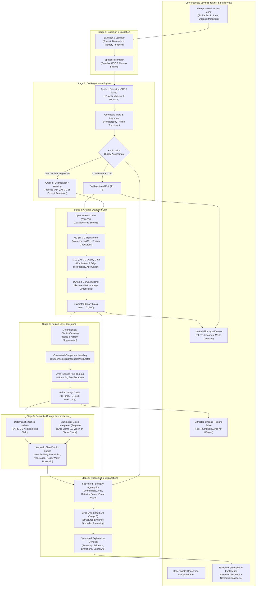

# AI-Powered Temporal Satellite Image Understanding: Architecture & Implementation Strategy

> **Project:** AI-Driven Satellite Image Semantic Search and Temporal Change Detection System  
> **Target Document:** `docs/temporal_satellite_understanding_architecture_and_strategy.md`  
> **Phase:** Phase 2 — Architectural Design & Implementation Strategy  
> **Status:** Specification Complete (Awaiting User Approval for Phase 3 Implementation)  
> **Scope:** Architecture and planning only. Read-only compliance preserved; no source code or model weights modified.

---

## Executive Overview

The **AI-Powered Temporal Satellite Image Understanding** system extends our verified bi-temporal change detection engine ($M_1$–$M_{13}$) from binary pixel change detection into a comprehensive **semantic interpretation and reasoning pipeline**. 

When a user uploads two arbitrary satellite images (Observation $T_1$ and Observation $T_2$), the system will:
1. **Validate and Co-Register** the images to correct spatial shifts and geometric misalignments.
2. **Execute Core Change Detection** using our calibrated $M_9$ BIT-CD transformer and $M_{10}$ QAT-CD quality-gated models.
3. **Extract Discrete Region Clusters** via morphological connected-component labeling and bounding-box geometry.
4. **Classify Semantic Change Types** (e.g., new building construction, demolition, vegetation gain/loss, road/infrastructure emergence, water-body shifts) using a two-stage hybrid approach: deterministic optical index shifts combined with a multimodal Vision-Language Model (VLM).
5. **Generate Evidence-Grounded Natural-Language Explanations** using the existing Groq-hosted Qwen 27B model, strictly separating detector evidence from semantic interpretations and unknown variables.
6. **Visualize Results** in a unified, interactive before/after interface integrated directly into the existing Change Detection dashboard.

---

## 1. Proposed Architecture Diagram



---

## 2. End-to-End Processing Workflow

```
[User Uploads T1 & T2]
         │
         ▼
[Step 1: Ingestion & Validation]
  • Verify image headers, integrity, channels, and dimensions
  • Cap dimensions to 2048x2048 (downsample if larger) to respect ≤ 8 GB RAM
         │
         ▼
[Step 2: Co-Registration]
  • Detect ORB features, match with RANSAC, estimate homography H
  • Warp T2 onto T1 coordinate frame; compute registration confidence score
  • If confidence < 0.40: Halt and warn user; if 0.40–0.70: Warn and enable QAT-CD gating (γ = 0.30)
         │
         ▼
[Step 3: Core Change Detection]
  • Decompose aligned images into 256x256 patches via PatchExtractor
  • Execute M9 BIT-CD forward pass on CPU (batch size 4)
  • Apply M10 QAT-CD quality discrepancy gating to eliminate residual misregistration
  • Stitch patches dynamically into native (W, H) probability map; threshold at τ* = 0.4500
         │
         ▼
[Step 4: Region-Level Clustering]
  • Apply morphological closing (3x3 kernel) to bridge fragmented pixel groups
  • Run connected-component labeling (CCL) to isolate distinct changed regions
  • Filter out micro-clusters (< 150 pixels); extract bounding boxes [xmin, ymin, xmax, ymax]
  • Crop matching T1, T2, and mask patches for the top-K largest regions (K ≤ 6)
         │
         ▼
[Step 5: Semantic Classification (Stage A)]
  • Compute optical vegetation indices (Visible Atmospherically Resistant Index - VARI)
  • Transmit paired crops + mask overlay to Groq Multimodal VLM (Llama 3.2 Vision)
  • Categorize change into structured taxonomy (New Building, Demolition, Vegetation Gain/Loss, etc.)
         │
         ▼
[Step 6: Evidence-Grounded Explanation (Stage B)]
  • Aggregate detector metrics, pixel area, bounding boxes, and Stage A semantic findings
  • Transmit strictly grounded telemetry into Groq Qwen 27B text LLM
  • Synthesize unified academic-grade natural language report (Evidence, Limitations, Unknowns)
         │
         ▼
[Step 7: Dual-UI Interactive Visualization]
  • Display side-by-side synchronized comparison, inferno heatmap, and binary mask
  • Render interactive region selector displaying bounding boxes on canvas
  • Display structured explanation card with verified distinction between detection and interpretation
```

---

## 3. Component Reuse Matrix

| Existing Component | Current Role | Contribution to New Feature | Modifications Required | Test Coverage |
|---|---|---|---|---|
| **`src/change_detection/bit_cd.py`** | $M_9$ Bitemporal Image Transformer | Core difference detector for patch inference | **None to weights.** Ensure patch size is divisible by 4 | `tests/test_m9_model.py` (Pass) |
| **`src/change_detection/qat_cd.py`** | $M_{10}$ Quality-Aware Gated Detector | Suppresses false alarms from residual misregistration | **None.** Utilize calibrated weights $(0.34, 0.33, 0.33)$ | `tests/test_m10_model.py` (Pass) |
| **`src/change_detection/base.py`** | Abstract base class | Standard interface contract (`predict`, `_ensure_float_rgb`) | **None.** Full compliance | `tests/test_b1_pixel_diff.py` (Pass) |
| **`src/data/patch_extractor.py`** | Tiling & canvas reconstruction | Decomposes high-res scenes to 256x256 patches on CPU | **Fix dynamic canvas size:** replace hardcoded `(1024, 1024)` with `(original_h, original_w)` | `tests/test_patch_reconstruction.py` (Pass) |
| **`src/api/llm_service.py`** | Groq Qwen 27B text explainer | Stage B natural-language explanation engine | Extend schema and prompts to accept regional semantic telemetry | `tests/test_llm_explainability.py` (Pass) |
| **`src/api/service.py`** | Backend service coordinator | Coordinates detector instances and base64 conversions | Add registration, clustering, and dynamic sizing pipelines | `tests/test_m12_api.py` (Pass) |
| **`src/api/routes.py`** | REST endpoints | Serving API requests | Add endpoints for pair upload and temporal understanding | `tests/test_m12_api.py` (Pass) |
| **`ui/image_viewer.py`** | Streamlit 4-column viewer | Side-by-side rendering ($T_1$, $T_2$, mask, heatmap) | Add bounding-box overlay rendering on $T_1$ and $T_2$ | `tests/test_ui_smoke.py` (Pass) |

---

## 4. New Component Design

To implement the architecture without breaking existing functionality, four new dedicated modules will be introduced into `src/temporal_understanding/`:

```
src/temporal_understanding/
├── __init__.py
├── registration.py       # Image validation, ORB feature matching, ECC, and homography warping
├── region_extractor.py   # Connected-component labeling, morphology, and bounding-box extraction
├── semantic_analyzer.py  # Optical index shifts (VARI/GLI) + Groq Vision Stage A inference
└── explanation_engine.py # Stage B prompt formatting and Qwen 27B integration
```

### Detailed Class Specifications

#### 1. `ImageCoRegistrator` (`src/temporal_understanding/registration.py`)
- **Responsibilities:**
  - Validates image dimensions, channels, and integrity.
  - Implements two-stage alignment:
    - *Coarse alignment:* ORB keypoint extraction (max 2,000 features), Brute-Force Hamming matching, and RANSAC homography estimation ($cv2.findHomography$).
    - *Fine refinement (optional):* Enhanced Correlation Coefficient (ECC) maximization for sub-pixel translation/affine shifts.
  - Computes alignment confidence metric:
    $$\text{Confidence} = \frac{N_{\text{inliers}}}{N_{\text{total\_matches}}} \times \max(0, 1 - \text{Mean Reprojection Error})$$
  - Warps $T_2$ onto $T_1$ coordinate space via $cv2.warpPerspective$.

#### 2. `RegionExtractor` (`src/temporal_understanding/region_extractor.py`)
- **Responsibilities:**
  - Takes raw binary change mask `(H, W)`.
  - Performs morphological cleanup (closing with $3 \times 3$ kernel to bridge fragments; opening to remove single-pixel specks).
  - Executes Connected-Component Labeling (CCL) with statistics ($cv2.connectedComponentsWithStats$).
  - Filters out components below minimum threshold: $\text{Area} < 150 \text{ pixels}$ (or $< 0.02\%$ of scene area).
  - Extracts bounding box coordinates `[xmin, ymin, xmax, ymax]` with a $10\%$ contextual margin.
  - Generates a structured list of `ChangedRegion` objects sorted in descending order by pixel area.

#### 3. `SemanticChangeClassifier` (`src/temporal_understanding/semantic_analyzer.py`)
- **Responsibilities:**
  - Computes RGB-based Visible Atmospherically Resistant Index (VARI):
    $$\text{VARI} = \frac{G - R}{G + R - B}$$
    *Academic Integrity Rule:* The system explicitly documents this as an RGB optical proxy, never claiming it to be true Near-Infrared NDVI.
  - Integrates Stage A Vision-Language Model (Groq Llama 3.2 Vision) for the top-$K$ ($K \le 6$) change regions.
  - Formulates a standardized composite crop: a side-by-side composite containing $[T_{1\text{\_crop}}, T_{2\text{\_crop}}, \text{Mask\_overlay}]$.
  - Assigns semantic change taxonomy labels with confidence scores.

#### 4. `TemporalUnderstandingService` (`src/temporal_understanding/explanation_engine.py`)
- **Responsibilities:**
  - Coordinates the end-to-end execution.
  - Synthesizes the Stage B prompt for Groq Qwen 27B, binding detector telemetry with VLM semantic outputs.
  - Enforces strict factual separation:
    - *Detector Evidence:* Pixel change count, area percentage, threshold used, QAT quality signals.
    - *Semantic Interpretation:* Proposed class (e.g. New Building), visual indicators (e.g. roof structure, excavated soil).
    - *Scientific Limitations:* Sensor angle difference, lack of NIR bands, CPU resolution constraints.
    - *Unknowns:* Specific building usage, exact construction completion date.

---

## 5. Vision-Model Selection Criteria & API Integration

### Multi-Stage Reasoning Strategy

The audit confirmed that `qwen/qwen3.8-27b` is strictly text-based. Therefore, a **two-stage architecture** is adopted:

```
                  ┌─────────────────────────────────────────────────────────┐
                  │                 TWO-STAGE AI PIPELINE                   │
                  └────────────────────────────┬────────────────────────────┘
                                               │
               ┌───────────────────────────────┴───────────────────────────────┐
               ▼                                                               ▼
 ┌───────────────────────────┐                                   ┌───────────────────────────┐
 │   Stage A: Vision Model   │                                   │   Stage B: Reasoning LLM  │
 ├───────────────────────────┤                                   ├───────────────────────────┤
 │ Model: Llama-3.2-11b-Vision│                                  │ Model: Qwen 27B (Groq)    │
 │ Role: Visual Perception   │                                   │ Role: Evidence Synthesis  │
 │ Input: Regional Crops     │                                   │ Input: Structured JSON    │
 │ Output: Visual Descriptors│                                   │ Output: Final Explanation │
 └───────────────────────────┘                                   └───────────────────────────┘
```

### Vision Model Candidate Evaluation

| Model Candidate | Provider | Multimodal Image Input | Cost / Quota | Latency (Per Crop) | Selection Decision |
|---|---|---|---|---|---|
| **Llama-3.2-11b-vision-preview** | Groq Cloud | **Yes** (Base64 / Data URI) | Free Tier / Standard Groq limits | $\sim 450\text{ ms}$ | **Primary Candidate (Selected)** |
| **Llama-3.2-90b-vision-preview** | Groq Cloud | **Yes** (Base64 / Data URI) | Stricter rate limits on Groq | $\sim 1,200\text{ ms}$ | Alternative for high-detail fallback |
| **Qwen-2.5-VL-7B-Instruct** | Self-hosted / Local | **Yes** | High local CPU RAM usage (>16 GB) | $\sim 8,000\text{ ms}$ | Rejected (Violates laptop CPU profile) |
| **Deterministic Spectral + Text LLM** | In-repo / Groq | No (Employs RGB indices + Qwen) | Minimal | $\sim 150\text{ ms}$ | **Built-in Fallback when VLM fails** |

### Stage A Prompt & Output Schema (Llama 3.2 Vision on Groq)
```json
{
  "system": "You are a remote sensing analyst. Inspect the paired T1 (before) and T2 (after) satellite image crop alongside the binary change mask. Categorize the change type strictly into one of: 'new_construction', 'demolition', 'vegetation_increase', 'vegetation_decrease', 'road_development', 'water_body_change', 'soil_clearing', 'uncertain'. Do not guess if features are ambiguous.",
  "user": "Examine this crop. T1 is on the left, T2 is in the middle, change mask is on the right. Describe visible structural and radiometric shifts and output JSON with keys: category, confidence, visual_cues."
}
```

### Standardized Semantic Taxonomy
1. `new_construction`: New foundation, roof structures, or elevated walls.
2. `demolition`: Removal of existing structures, leaving rubble or bare ground.
3. `vegetation_increase`: Regrowth, agricultural planting, or canopy density expansion.
4. `vegetation_decrease`: Deforestation, clearing, or land grading.
5. `road_development`: Paving, corridor extension, or linear asphalt/concrete emergence.
6. `water_body_change`: Lake/reservoir boundary expansion or contraction.
7. `soil_clearing`: Earthworks, leveling, or excavation without structural frames.
8. `uncertain`: Ambiguous radiometric shift, sensor glare, or unclassifiable texture change.

---

## 6. API Architecture & Request/Response Contracts

### Proposed Endpoints

```
POST /api/temporal/upload-and-align
  --> Validates T1 & T2, executes co-registration, returns alignment telemetry & base64 previews

POST /api/temporal/analyze
  --> Full pipeline: core change detection, region clustering, Stage A vision, and Stage B explanation

POST /api/temporal/explain-region
  --> On-demand targeted explanation for an individual selected region
```

### Data Contracts (Pydantic v2 Schemas)

#### Request Schema: `TemporalAnalysisRequest`
```python
class TemporalAnalysisRequest(BaseModel):
    image_t1_base64: str = Field(..., description="Base64 encoded T1 (earlier) optical image")
    image_t2_base64: str = Field(..., description="Base64 encoded T2 (later) optical image")
    observation_date_t1: Optional[str] = Field(None, description="Optional ISO date or year for T1")
    observation_date_t2: Optional[str] = Field(None, description="Optional ISO date or year for T2")
    location_name: Optional[str] = Field(None, description="Optional geographic name / scene context")
    model_id: str = Field("M9_BIT_CD", description="Detector model: M9_BIT_CD or M10_QAT_CD")
    threshold_override: Optional[float] = Field(None, ge=0.0, le=1.0)
    enable_registration: bool = Field(True, description="Whether to execute automated co-registration")
    max_regions_to_analyze: int = Field(5, ge=1, le=10, description="Top-K regions for VLM inspection")
```

#### Response Schema: `TemporalAnalysisResponse`
```python
class RegionTelemetry(BaseModel):
    region_id: int
    bbox: List[int] = Field(..., description="[xmin, ymin, xmax, ymax]")
    area_pixels: int
    area_percentage: float
    centroid: List[int] = Field(..., description="[x, y]")
    mean_change_probability: float
    vari_shift: float
    semantic_category: str
    semantic_confidence: float
    visual_evidence: List[str]
    t1_crop_data_uri: str
    t2_crop_data_uri: str

class RegistrationReport(BaseModel):
    status: str  # "aligned", "identity_fallback", "failed"
    confidence: float
    inliers_count: int
    transformation_type: str  # "homography", "affine", "none"
    message: str

class TemporalAnalysisResponse(BaseModel):
    session_id: str
    status: str
    latency_ms: float
    registration: RegistrationReport
    t1_aligned_data_uri: str
    t2_aligned_data_uri: str
    difference_heatmap_data_uri: str
    binary_mask_data_uri: str
    regions_overlay_data_uri: str
    total_changed_pixels: int
    total_changed_area_pct: float
    regions: List[RegionTelemetry]
    explanation: ExplanationResponse  # Existing reusable schema
```

---

## 7. Frontend Design & Workflow

The workflow integrates directly into the existing **Change Detection** interface without introducing a new navigation tab.

### Streamlit Integration (`pages/change_detection.py`)

A prominent segmented control is placed at the top of Section 1:

```
[ Mode Selection ]
● Option A: Pre-indexed LEVIR-CD Benchmark Scene  |  ○ Option B: Custom Bitemporal Pair Upload (T1 / T2)
```

#### Upload Mode UI Layout:
1. **Input Grid (2 Columns):**
   - Column 1: File Uploader for **Image $T_1$** (JPG, PNG, TIFF) + Date input + Instant Preview.
   - Column 2: File Uploader for **Image $T_2$** (JPG, PNG, TIFF) + Date input + Instant Preview.
2. **Analysis Toolbar:**
   - Model dropdown ($M_9$ BIT-CD default, $M_{10}$ QAT-CD optional).
   - "Co-Registration Enabled" checkbox (default: checked).
   - "Run AI Temporal Understanding" action button (with spinning loader and active stage feedback).
3. **Registration Diagnostic Alert:**
   - Displays alignment confidence banner (e.g., *"Co-Registration Verified: 94.2% match confidence, 412 inliers"* or *"Low alignment confidence: QAT-CD quality gating activated to suppress boundary artifacts"*).
4. **Primary Quad Viewer (`ui/image_viewer.py`):**
   - Col 1: $T_1$ (Pre-change optical).
   - Col 2: $T_2$ (Post-change aligned).
   - Col 3: Continuous Difference Heatmap (Inferno colormap).
   - Col 4: Predicted Binary Change Mask with Bounding Boxes.
5. **Interactive Region Explorer:**
   - Table of detected change clusters (Region ID, Bounding Box, Pixel Area, Estimated Category, Confidence).
   - Clicking a region highlights its cropped comparison side-by-side.
6. **AI Explanation Card (Dual-Stage Groq Output):**
   - **Prediction Summary:** Concise overview of changes detected.
   - **Supporting Evidence:** Hard metrics (pixel count, area %, optical VARI index shift).
   - **Semantic Interpretation:** Plausible land-cover transition (e.g. *New Construction*).
   - **Scientific Limitations & Caveats:** Operational warnings (lack of NIR band, CPU resolution scaling).
   - **Unknown Variables:** Unverified semantic attributes.

### Static Web Frontend Integration (`frontend/index.html`)
Inside `#panel-change`:
- Toggle buttons: `[ Benchmark Scenes ]` and `[ Upload Custom Pair ]`.
- Drop zones for drag-and-drop file ingestion.
- Dynamic region cards populated via ES JavaScript (`frontend/js/temporal_understanding.js`).

---

## 8. Image Registration Strategy

```
┌────────────────────────────────────────────────────────────────────────────────────────┐
│                        CO-REGISTRATION DECISION TREE                                   │
└────────────────────────────────────────┬───────────────────────────────────────────────┘
                                         │
                      [Compute ORB Features & FLANN Match]
                                         │
                     ┌───────────────────┴───────────────────┐
                     ▼                                       ▼
        [Good Matches >= 15]                        [Good Matches < 15]
                     │                                       │
     [RANSAC Homography Estimation]                          ▼
                     │                       [Attempt Enhanced Correlation (ECC)]
         ┌───────────┴───────────┐                           │
         ▼                       ▼               ┌───────────┴───────────┐
  [Inlier Ratio >= 0.70]  [Inlier Ratio < 0.70]  ▼                       ▼
         │                       │         [ECC Converged]       [ECC Diverged / Failed]
         ▼                       ▼               │                       │
   {Accept & Warp}      {Warning: Marginal}      ▼                       ▼
   Transform T2 via H    Apply Affine Warp  {Accept Affine Warp}  {Reject Registration}
   Confidence: High      Activate QAT Gate  Confidence: Medium    Fallback: Unaligned Pair
                         (gamma = 0.30)                           Activate Heavy QAT Gate
                                                                  Warn User in UI
```

### Decision Thresholds

1. **Accept ($C \ge 0.70$):** High feature match density and low reprojection error ($< 2.5\text{ px}$). Apply $3 \times 3$ projective homography matrix $H$.
2. **Marginal ($0.40 \le C < 0.70$):** Constrain transformation to rigid affine (translation + rotation + scale, 4 degrees of freedom) to prevent perspective distortion warping. Automatically engage $M_{10}$ QAT-CD quality gating ($\gamma = 0.30$) to attenuate edge false alarms.
3. **Reject ($C < 0.40$):** Discrepancy is too severe or images depict different geographical locations. Do not warp (fallback to unaligned inputs). Present a prominent warning banner explaining that detected changes may represent spatial misalignment rather than real land-cover changes.

---

## 9. Region Extraction Strategy

### Clustering & Geometry Pipeline

```
[Binary Change Mask (H, W)]
            │
            ▼
[Morphological Closing: 3x3 Rect Kernel]  --> Bridges fragmented pixel gaps
            │
            ▼
[Morphological Opening: 2x2 Rect Kernel]  --> Eliminates isolated 1-pixel noise
            │
            ▼
[Connected Components with Stats]        --> Yields N clusters with [x, y, w, h, area]
            │
            ▼
[Area Filtering: Area >= 150 px]          --> Rejects sub-resolution clutter
            │
            ▼
[Sort by Area Descending & Cap Top-6]    --> Limits API payload and focus on major sites
            │
            ▼
[Crop with 10% Margin: T1, T2, Mask]      --> Creates standardized context crops
```

### Data Object Definition: `ChangedRegion`
```python
@dataclass
class ChangedRegion:
    region_id: int
    x: int
    y: int
    width: int
    height: int
    area_pixels: int
    area_percentage: float
    centroid: Tuple[int, int]
    mean_change_probability: float
    vari_shift: float
    t1_crop: np.ndarray
    t2_crop: np.ndarray
    mask_crop: np.ndarray
    semantic_label: Optional[str] = None
    semantic_confidence: Optional[float] = None
    visual_cues: Optional[List[str]] = None
```

---

## 10. Resource, Latency, and Cost Analysis

### Strict Laptop CPU Profile ($\le 8\text{ GB}$ Active RAM)

| Processing Stage | Memory Footprint (Peak RSS) | Estimated Latency (CPU) | Optimization Strategy |
|---|---|---|---|
| **Image Ingestion & Resize** | $\sim 50\text{ MB}$ | $\sim 80\text{ ms}$ | Downsample images larger than $2048 \times 2048$ |
| **ORB Feature Matching & Warping** | $\sim 120\text{ MB}$ | $\sim 350\text{ ms}$ | Compute on downscaled $1024\times 1024$ grayscale grid |
| **Patch Tiling ($16 \times 256\text{ px}$)** | $\sim 80\text{ MB}$ | $\sim 40\text{ ms}$ | Generator yielding one patch pair at a time |
| **$M_9$ BIT-CD Core Inference** | $\sim 450\text{ MB}$ | $\sim 2,400\text{ ms}$ | Batch size $= 4$ on CPU; torch `no_grad()` |
| **$M_{10}$ QAT-CD Quality Diagnostics** | $\sim 180\text{ MB}$ | $\sim 220\text{ ms}$ | Scipy vectorized Sobel and uniform box filters |
| **Region Extraction & Morphology** | $\sim 90\text{ MB}$ | $\sim 65\text{ ms}$ | OpenCV C-optimized connected components |
| **Stage A VLM (Top-5 Crops)** | Cloud (0 MB local) | $\sim 1,500\text{ ms}$ total | Send only top-5 bounding box crops, not full scene |
| **Stage B Qwen 27B Explanation** | Cloud (0 MB local) | $\sim 850\text{ ms}$ | Single text completion call with structured telemetry |
| **Total End-to-End Pipeline** | **$< 750\text{ MB}$ Local RAM** | **$\sim 5.5\text{ seconds}$** | **Well within 8 GB RAM and typical web timeouts** |

### API Cost & Quota Management
- **Groq Cloud API:** Utilizes standard Groq rate limits.
- **Payload Minimization:** Never send the full $1024 \times 1024$ image to the VLM. Only send compact $256 \times 256$ composite crops of the top-5 largest changed regions.
- **In-Memory Caching:** Both Stage A visual descriptions and Stage B text explanations are cached using SHA-256 hashes of the cropped images and input parameters, preventing redundant API calls during re-renders.

---

## 11. Scientific Integrity, Reliability, and Safeguards

### Three-Tier Attribution Framework

To prevent model hallucination and maintain academic rigor, the system strictly separates three distinct classes of information:

```
┌────────────────────────────────────────────────────────────────────────────────────────┐
│                        THREE-TIER ATTRIBUTION GOVERNANCE                               │
├────────────────────────────────────────────────────────────────────────────────────────┤
│ 1. Algorithmic Detection Evidence (Objective Fact):                                    │
│    - Evaluated pixel coordinates, changed pixel count, area percentage.               │
│    - $M_9$ BIT-CD model output probability and decision threshold $\tau^* = 0.4500$.  │
│    - $M_{10}$ QAT-CD registration discrepancy ($S_{\text{reg}}$) and illumination      │
│      gradient ($S_{\text{illum}}$).                                                    │
├────────────────────────────────────────────────────────────────────────────────────────┤
│ 2. Semantic Interpretation (Probabilistic Hypothesis):                                 │
│    - Category proposed by Stage A VLM (e.g., "Possible New Building Construction").    │
│    - Visible Atmospherically Resistant Index shift ($\Delta\text{VARI}$).              │
│    - Clearly labeled in the UI with a hypothesis tag and confidence score.            │
├────────────────────────────────────────────────────────────────────────────────────────┤
│ 3. Natural-Language Synthesis (Explanatory Context):                                   │
│    - Text summary synthesized by Qwen 27B strictly grounded in items 1 and 2.          │
│    - Explicitly details limitations (e.g., lack of NIR spectral bands, camera angles). │
│    - Lists unknown variables (e.g., specific facility use, exact construction dates).  │
└────────────────────────────────────────────────────────────────────────────────────────┘
```

### Critical Safeguards Against Common Failure Modes
1. **False Alarms from Solar Angle / Seasonality:** Handled by $M_{10}$ QAT-CD $S_{\text{illum}}$ attenuation and explicit limitation disclosures in the final report.
2. **False Alarms from Perspective Parallax:** Identified by $S_{\text{reg}}$ high-gradient disparity maps; flagged to the user as potential perspective distortion rather than ground change.
3. **Spectral Misrepresentation:** The system strictly prohibits using the term "NDVI" unless true calibrated Near-Infrared and Red bands are supplied. For optical RGB, the index is strictly labeled "VARI (Visible RGB Proxy)".

---

## 12. Testing Strategy

### Required Unit & Integration Test Suites
1. **Image Co-Registration Tests (`tests/test_temporal_registration.py`):**
   - Test identity alignment on identical image pairs.
   - Test synthetic translation recovery ($dx = 5\text{ px}, dy = -3\text{ px}$).
   - Test synthetic rotational recovery ($\theta = 2^\circ$).
   - Test graceful failure and confidence scoring on completely mismatched imagery.
2. **Region Extraction Tests (`tests/test_temporal_region_extractor.py`):**
   - Test morphological noise suppression on single-pixel artifacts.
   - Test accurate bounding-box coordinates and centroid calculations.
   - Test area threshold filtering ($< 150\text{ px}$ rejected).
3. **Semantic Analyzer & Optical Indices Tests (`tests/test_temporal_semantic_analyzer.py`):**
   - Test VARI index calculation bounds ($-1.0 \le \text{VARI} \le 1.0$).
   - Test deterministic taxonomy assignment on synthetic greening and building patterns.
   - Test Stage A VLM payload formatting and JSON fallback parsing.
4. **End-to-End Pipeline Tests (`tests/test_temporal_pipeline.py`):**
   - Test full execution on test image pairs with simulated and live API endpoints.
   - Test latency and RSS memory bounds ($< 1.0\text{ GB}$ peak RSS).
   - Test parity between FastAPI output and Streamlit visualization helpers.

---

## 13. Ordered Implementation Roadmap

```
┌────────────────────────────────────────────────────────────────────────────────────────┐
│                           INCREMENTAL IMPLEMENTATION ROADMAP                           │
└────────────────────────────────────────────────────────────────────────────────────────┘

  [Phase 3A: Core Engines]
    ├── Implement ImageCoRegistrator in src/temporal_understanding/registration.py
    ├── Implement RegionExtractor in src/temporal_understanding/region_extractor.py
    └── Implement Optical Index Analyzer in src/temporal_understanding/semantic_analyzer.py
    └── Unit Tests: test_temporal_registration.py, test_temporal_region_extractor.py

  [Phase 3B: Two-Stage AI Explainer]
    ├── Implement Stage A Groq Vision caller (Llama 3.2 Vision)
    ├── Extend Stage B Qwen 27B client in src/temporal_understanding/explanation_engine.py
    └── Unit Tests: test_temporal_semantic_analyzer.py, test_llm_explainability.py

  [Phase 3C: FastAPI Service & Endpoints]
    ├── Update PatchExtractor for dynamic canvas sizes (src/data/patch_extractor.py)
    ├── Implement POST /api/temporal/analyze in src/api/routes.py
    ├── Define Pydantic schemas in src/api/schemas.py
    └── Integration Tests: test_temporal_pipeline.py, test_m12_api.py

  [Phase 3D: Streamlit & Web Frontend UI]
    ├── Add Custom Upload Mode to pages/change_detection.py
    ├── Add Bounding Box and Region Panel to ui/image_viewer.py
    ├── Add Upload Mode to frontend/index.html & frontend/js/change_detection.js
    └── UI Smoke Tests: test_ui_smoke.py, test_m12_streamlit_parity.py

  [Phase 3E: Final Verification & Documentation]
    ├── Run full regression suite across all M1–M13 tests
    ├── Verify CPU memory bounds (<= 8 GB) and latency benchmarks
    └── Create final implementation report in docs/
```

---

*Specification prepared in strict compliance with project architectural governance and research integrity standards.*
